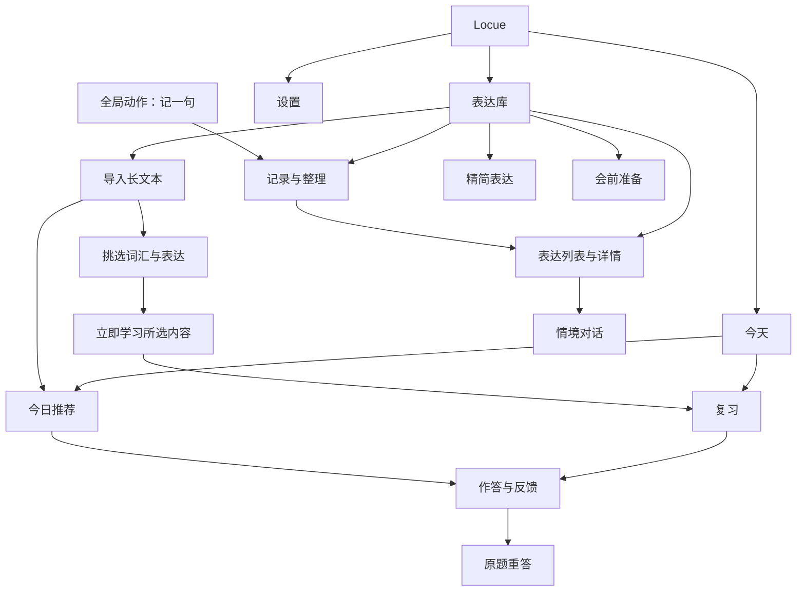
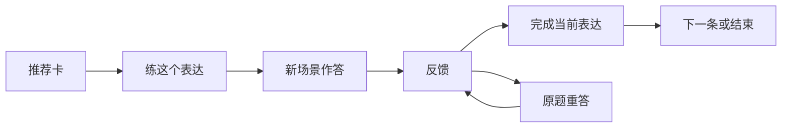
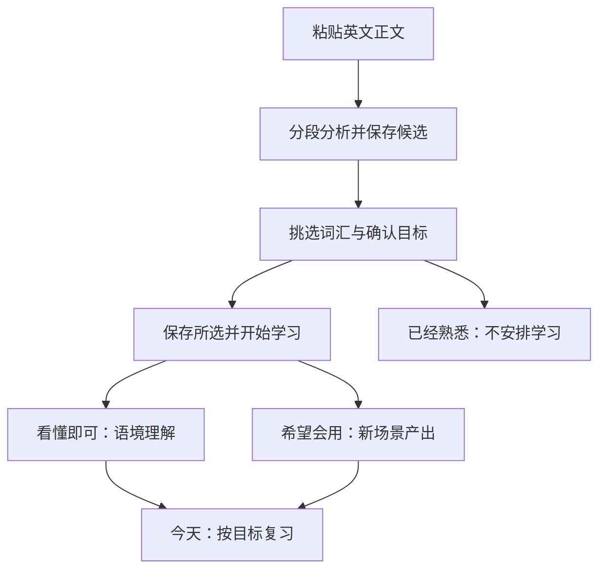

# Locue · 产品需求与实施路线

> 版本：v2.4 · 更新：2026-10-22
> 当前公开版本：Android 预览版 0.4.7 / versionCode 20，包含 Gemini 原生协议。Android 优先，Web 共享产品逻辑。
> 本文是产品需求、完成状态、验收要求和实施顺序的唯一维护入口。新设计直接补入相应章节，已完成项保留并更新状态。
> **当前位置：阶段 A—D.6 已完成；P0 词汇学习闭环（F36—F38）的代码、自动化和真实 Gemini 词汇服务回归已通过；0.4.7 代码与同签名 APK 发布至 GitHub。Gemini 原生协议的自动化、配置浏览器验证、中转及 Google 原厂直连回归通过，Android 模拟器覆盖升级和原厂自检通过；VOC-M4 的完整浏览器/Android 设备验收仍待验证。**

## 阅读导航

- [0. 当前状态与完整功能路线](#status)
- [1. 产品定位、原则与边界](#principles)
- [2. 用户旅程与信息架构](#navigation)
- [3. 今天、推荐与复习](#today)
- [4. 全局速记与中断恢复](#capture)
- [5. 表达库、整理与工具](#library)
- [5.8 词汇学习闭环：当场挑选与立即学习（P0）](#vocabulary)
- [6. 教学反馈与原题重答](#feedback)
- [7. 学习引擎与情境对话](#learning)
- [8. 状态、数据与服务约束](#state)
- [9. 文案、视觉与可访问性](#visual)
- [10. 验收、效果评估与风险](#acceptance)
- [11. 分期实施与当前起点](#roadmap)
- [12. 决策记录与文档维护](#maintenance)

## 0. 当前状态与完整功能路线

### 0.1 状态口径

| 状态 | 含义 |
| --- | --- |
| 已完成 | 对应实现已在基线版本中存在；具体平台和验证范围以本章及验收章节为准 |
| 部分完成 | 已有基础能力，但仍有明确的需求或交互缺口 |
| 待实施 | 设计已纳入路线，基线版本尚无完整实现 |
| 待验证 | 已有实现或设计假设，缺少对应的真实服务、实体设备或长期使用证据 |
| 后续规划 | 保留方向及进入条件，不进入当前开发批次 |

“已完成”不等于所有设备和模型均已验证；设计写入本文也不等于已经上线。后续正文描述**目标行为**，实际完成情况统一看本章，不从一段流程描述推断状态。

### 0.2 原始功能路线 F1—F25

保留原编号，方便查阅历史；原 P0/P1/P2 与 W1—W4 是历史优先级，当前顺序以第 11 章为准。

| ID | 能力 | 当前状态 | 已有实现与剩余工作 |
| --- | --- | --- | --- |
| F1 | 快速记录 | 部分完成 | 已有全局独立“记一句”面板、离线记录、独立草稿、收起/存好/另记一句和桌面快捷入口；待完成真机耗时、语音尾包及中断返回实测 |
| F2 | 待处理记录 | 已完成 | 记录已迁入表达库，区分草稿、待整理、正在整理、待查看、整理失败和已处理；支持整理、精简、保留与删除，处理后原记录可回看 |
| F3 | 译写、改写、衍生分析 | 已完成 | 支持原句保留、必要纠错、可选优化、空骨架、复用已有条目和新增骨架的完整契约 |
| F4 | 首次主动产出 | 已完成 | 收录后造句、文本判卷、统一尝试记录和反馈后原题重答已接通；保留记录或完成整理不强制入库、造句 |
| F5 | 固定阶梯复习 | 已完成 | `0 / 1 / 3 / 7 / 21 / 60` 天，失败退一阶并 8 小时后重来；完整会话幂等结算另见 F29/F31 |
| F6 | 分阶段召回 | 已完成 | 第 0—2 阶指导练习，第 3—5 阶隐藏英文提示；今天页直接作答并冻结最多 5 条的短组 |
| F7 | 真实使用与掌握状态 | 已完成 | 用户主动记录真实使用；`box >= 4 && realUses >= 3` 才达到掌握条件 |
| F8 | 精简表达 | 已完成 | 支持段落精简、零新增正常出口、骨架提炼、记录来源返回、最近任务恢复及不入库的原意脱稿重述；压缩率只作事实展示 |
| F9 | 会前准备 | 已完成 | 已有按会议情境生成建议、优先复用、热身入口和最近一次输入/结果/请求状态恢复；跨会议历史仍按范围后置 |
| F10 | 表达库 | 已完成 | 已有表达/记录分区、本地搜索、状态筛选、详情、归档、学习记录及固定工具入口；搜索条件、分区、筛选和返回位置在当前运行期保留 |
| F11 | 学习偏好 | 已完成 | 已有画像配置，设置和推荐均可进入；包含默认关闭的生活用语推荐开关，命名统一随 F30 完成 |
| F12 | 模型接入与自检 | 已完成 | 区域 Profile、高级自定义配置、模型与语音双 Key、首启文本/ASR/TTS 验证；0.4.7 增加 Gemini 原生协议及 Google 默认配置，中转/原厂词汇回归及 Android 模拟器原厂自检通过；不改为旧版“三个空框、可跳过” |
| F13 | 本地通知 | 已完成 | 到期提醒、降频、权限引导和通知跳转；Android 16 模拟器已通过七日调度、重启恢复与深度 Doze 精确提醒，真实锁屏和厂商省电差异仍待实体设备验证 |
| F14 | 持久化与备份 | 已完成 | Android SQLite、Web IndexedDB、安全凭证存储、每日备份与导入导出；已发布状态格式 v13，本地词汇增量 v14 的迁移与备份自动化通过；既有 Android 16 模拟器覆盖升级证据仍适用于 v13，v14 设备升级待验收 |
| F15 | 系统分享捕获 | 部分完成 | Android 文本摄取、分享不清空草稿且不抢当前练习路由已完成；Android 16 模拟器系统选择器已验证文本落入独立记录，仍需实体设备验证重复投递和厂商选择器差异 |
| F16 | 通知内快捷回复 | 已完成 | 已有收取文本、回前台判卷链路；Android 16 模拟器通知栏回复已恢复同一题并预填答案，真实锁屏回复和连续使用待验证 |
| F17 | 语音输入与朗读 | 已完成 | 系统/云端模式、区域语音、可编辑转写与降级；误导性语音评分已下线。真人识别质量和时延待验证 |
| F18 | 提示词评测与回归 | 部分完成 | 已有评测脚手架、契约测试和部分真实云端走查；20—30 条个人真实语料、完整质量基线与持续回归待补齐 |
| F19 | 个人表达问题档案 | 后续规划 | 聚合 3—5 类反复出现的问题，针对性练习；需先有可信反馈和真实样本 |
| F20 | 两轮情境对话 | 已完成 | 独立会话、两轮交互、恢复、判定、单次调度及指定回合局部重答已实现；真实评测集和两周训练价值待验证 |
| F21 | 会后回收 | 后续规划 | 显式授权后考虑日历联动，会议结束约 20 分钟后轻量回访；不默认监听会议 |
| F22 | 飞书机器人入口 | 后续规划 | 聊天中记录表达的便利入口；不替代现有本地通知 |
| F23 | 长文本语料导入 | 已完成 | 粘贴正文、分块提炼、逐字证据校验、去重、中断续跑和候选渐进推荐已发布；F36 承接的当场挑选、立即学习与按义项去重已在本地实现，整体验收待完成 |
| F24 | 多设备 | 后续规划 | 优先评估用户自有网盘与文件备份；先解决一致性、冲突和恢复，不能直接把运行中的 SQLite 文件互相覆盖 |
| F25 | 月度输出体检 | 后续规划 | 新增表达、掌握与真实使用变化、表达问题变化；不以时长或收藏量充当学习收益 |

### 0.3 后续新增需求

| ID | 能力 | 当前状态 | 本轮范围 |
| --- | --- | --- | --- |
| F26 | 每日推荐与场景迁移 | 已完成 | 推荐生成、收录、换场景练习、进度同步、今天内模式切换、显式开始、完成结算及跨日原题恢复已实现；旧批次不占新一天进度，真实连续使用效果待验证 |
| F27 | Locue 品牌与基础视觉 | 已完成 | 英文品牌、移调引号图标、C1 湖蓝、瓷白启动器底色、圆角、两目的地导航与键盘态速记入口已交付；桌面图标与应用内浅色工具语言一致，底栏图标和标签严格居中且不显示易误读为未读消息的草稿红点 |
| F28 | 可信反馈与可选优化 | 已完成 | 误导性语音评分已下线；捕获、普通判卷和原意重述已统一 `keep/correct/optional`，并支持 `none/reuse/new` 准入与无新骨架正常完成 |
| F29 | 原题重答与转写修订 | 已完成 | 普通练习、查看答案、精简和对话局部重答已接通；最多两次有效重答，首答/重答分开记录，语音原转写与确认文本分离，同会话只结算一次 |
| F30 | 主线与信息架构重组 | 已完成 | 今天/表达库两个目的地、全局记一句、今天内复习/推荐、默认选择、短组与分层结束状态已实现 |
| F31 | 统一会话与异步保护 | 已完成 | 普通练习已持久化题面、答案、尝试、来源与结算快照；判卷绑定会话/尝试并幂等结算，晚回调不抢页面，通知与各练习入口均有独立来源 |
| F32 | 工具任务恢复 | 已完成 | 精简与会前输入、结果和请求状态均持久化；返回页面不重复请求，重启时未完成请求转为可重试状态，不扩展成会议管理系统 |
| F33 | iOS 平台交付 | 后续规划 | 共享业务逻辑，单独验收壳、权限、分享扩展、语音与签名；不视为 Android 已完成的附带成果 |
| F34 | 托管身份、额度与模型代理 | 后续规划 | 正式多用户服务的条件路线：托管 OIDC + PKCE、短期令牌、额度和代理；当前单用户客户端不新增后端 |
| F35 | 词汇与表达联动 | 已完成 | `term` 下区分专业词汇、精确用词和生活用语；旧词汇默认专业类，推荐目标约 4 表达 + 1 词汇，生活类仅在用户显式开启后生成；统一筛选、详情、搜索、场景产出练习和调度 |
| F36 | 导入后当场选词与学习 | 部分完成 | 代码已接通词汇优先候选、逐条/批量目标、原文补选、可靠保存和最多 5 条学习组；隔离浏览器已验证选择、保存和理解卡；真实 Gemini 已验证候选提取及补选，完整设备交互待验收 |
| F37 | 词汇学习目标与两种路径 | 部分完成 | 两目标、有限理解巩固、产出阶梯及切换保护已实现并通过自动化；真实 Gemini 的理解/产出材料与目标词判卷通过，个人语料质量基线与真实隔日理解待验证 |
| F38 | 词汇复习、恢复与证据区分 | 部分完成 | 今天/提醒、理解历史、备份 v14、旧数据兼容和恢复已实现；浏览器已验证理解草稿/提示刷新恢复，设备覆盖升级和完整交互矩阵待验收 |

### 0.4 当前证据与未验证事项

2026-09-19 阶段 E 自动化批次已完成 31 个测试文件、174 项自动化测试、类型检查、生产构建与 `git diff --check`。新增覆盖跨日未完成推荐恢复、旧批次与新日进度隔离、桌面快捷速记、分享不抢当前路由、通知回复优先、后台落盘、键盘优先返回、底栏无草稿红点、不可选中文字、复习操作稳定布局，以及具体提示必须更换场景并生成与新题对应的英文答案。真实方舟模型此前已通过应用原始推荐契约；本轮复习迁移题已完成结构化契约与拒绝同题测试，模拟器真实调用受当前网络区域限制，未计为云端通过。

隔离浏览器 fixture 在 320 / 390 / 600 / 1280px 视口验证了当前两目的地导航、全局速记草稿跨页与重启、推荐浏览与练习、离线自评、工具入口和横向溢出；REC-05 专项另在 320 / 390 / 600px 验证了昨日答案恢复、刷新持久化、离线结算、完成后进入新一天，以及旧牌组 `practicedAt` 不变。`npm run android:debug` 已重新完成 Capacitor 同步和 Debug APK 构建。以上是可执行端验收，不替代实体设备验证。

Android 16 / API 36 模拟器（1080×2424，density 420）已用既有发布签名的 0.4.4 / versionCode 17 APK 完成覆盖安装，旧 SQLite、速记草稿、练习答案、表达和安全凭证均保留。设备级走查通过浅色自适应启动器图标、底栏居中与复习反馈操作布局、复习卡持续提供“换一个练习场景”入口、全局速记自动聚焦、返回键先收键盘再关面板、`sayable://capture`、强制停止及重启恢复、系统分享选择器、分享文本进入“待查看”且不抢当前练习、测试通知点击跳题、通知栏快捷回复、未来 7 天调度及 `BOOT_COMPLETED` 恢复。临时授予精确提醒权限后，模拟器在未加入电池优化白名单且处于深度 Doze 时准点投递；测试后已恢复通知关闭、21:30 提醒时间和默认精确权限。

真实服务已走通：普通判卷、通过但需纠正、两轮情境对话及恢复、生成 5 条推荐并完成其中 1 条、专业词汇 4+1 推荐、同日重复成功不再升阶、ASR 鉴权与 TTS、原生录音开始/停止、通知点击和分享摄取。阶段 D.6 的三类词汇与长文本语料能力对应 Android 预览版 0.4.5。

2026-09-24 阶段 D.6 长文本语料批次完成 33 个测试文件、187 项自动化测试、类型检查、生产构建、Release APK 覆盖安装和差异检查。Android 16 模拟器使用真实模型分别处理 AWS 服务网格文档、Istio 可观测性文档和播客式逐字稿，逐字证据校验后分别保留 3、4、4 条候选；覆盖安装、失败重试和冷启动后原文、下一分块、状态、来源及共 11 条候选均保留。首次 4,096 输出预算触发模型推理截断后已提高至 8,192，并将批量拒绝改为逐条确定性过滤；无效候选不会入池，单个坏候选不再拖垮整块。

本次优先级调整依据：用户近期听播客时，多处因不认识词汇而未理解内容，明确将词汇视为急需提升的短板，并希望导入后自己挑选、立即学习。F36—F38 的设计和代码已落地；本轮证据见第 11.5 节，不能沿用 F23/F35 的旧验收宣称新能力已完成。

2026-10-18 网络恢复后，最终代码在真实 Gemini 兼容服务完成词汇回归：工程访谈测试逐字稿保留 14 条候选（11 词汇、3 表达），过滤数为 0；gateway 自动提取遗漏后原文补选成功，认识材料、mitigate 产出材料、目标词通过/近义替代不推进和 inherited 词形还原均通过。修复词汇候选 `skeleton=null` 时误过滤有效 `lemma` 的契约缺陷，中文义项和理解解释校验及认识目标不生成产出题的回归通过。全量 203 项自动化、类型检查和 Release 构建通过，APK 内 19 个 Web 文件与测试构建一致。复测临时覆盖兼容地址和可用模型并关闭 JSON 模式，未修改 `.env`；原方舟配置仍报鉴权错误。浏览器桥仍超时，模拟器因 `HV_DENIED` 无法启动，因此本轮完整设备验收继续待办。

2026-10-22 的 Gemini 原生协议增量通过 35 个测试文件、221 项自动化（真实服务脚本默认跳过）、类型检查与生产构建。浏览器桥恢复后，真实设置组件通过自定义 Gemini 协议选择、保存、刷新恢复及海外 Google 默认配置选择。中转及 Google 原厂分别以 `generateContent` 协议完成词汇提取、认识/产出材料和目标词判卷。Android 模拟器同签名覆盖升级后，原厂模型自检和应用内候选提取通过。0.4.7 按用户授权发布至 GitHub，具体证据见 11.6—11.7；不扩大已有词汇整体验收范围。

| 待验证项 | 仍需证据 |
| --- | --- |
| 真人语音 | 真实口述准确率、口音/噪声/蓝牙、停止说话到 final 的 P95；鉴权和采集成功不等于识别质量合格 |
| 触达 | 模拟器已覆盖通知栏快捷回复、Doze、重启和系统分享选择器；仍需实体设备锁屏、厂商省电/选择器差异及连续 7 天 |
| 模型质量 | 完整反馈案例、20—30 条个人语料、20 个对话触发场景；精简与会前质量不能由普通判卷推定 |
| 学习效果 | 连续 7—14 天使用、换场景表达与真实使用；不能由测试数量或截图证明 |
| 本轮新动线 | 阶段 A—D.5 已完成，阶段 E 的自动化、浏览器、Android 构建和 Android 16 模拟器验收已通过；REC-05 设备跨午夜、实体设备矩阵及 14 天观察仍未完成 |

## 1. 产品定位、原则与边界

### 1.1 问题与核心价值

目标用户是能读懂英语、能开会，但没有整块学习时间的专业人士：听到好表达很快忘记；真正开口仍调用熟悉的简单词和中文组织方式；为交代信息不断补充，表达变长；认识的词说不出来。

近期补充问题：听播客或阅读原文时，也会因生词和固定短语不熟悉而漏掉关键信息。本次优先解决从真实语料中发现词汇缺口、选择学习深度并立即开始学习；这是一位核心用户的定性反馈，不推断为所有用户的词汇水平。

Locue 是英语表达训练工具，核心价值是：**把好表达变成你的表达。** 通过“检索—重组—复用”拓宽主动调用通道，而非要求每天投入一小时或不断增加知识量。

长期过程：**遇到或获得表达 → 理解用法 → 换场景主动产出 → 间隔复习 → 在真实沟通中使用。**

学习单元以可复用骨架为主，例如 `The bottleneck has shifted from X to Y.`，从原场景迁移到代码评审或数据质量。但一次记录、译写或精简可以正常结束而不创建骨架。

词汇是理解与表达的基础组件。词汇学习支持“看懂即可”和“希望会用”：前者建立语境理解，后者练习搭配和主动产出；具体规则见第 5.8、7.5 节。词汇短板是下一批次的优先问题，不以每日推荐的表达占比限制用户主动学习词汇。

### 1.2 产品原则

| 原则 | 要求 |
| --- | --- |
| 主线服务高频意图 | 日常打开直接练推荐或复习；不要求每次先捕获 |
| 捕获低阻力 | 先本地保存再返回；不等待联网、分析、选择类型或评分。2 秒是交互愿景，具体测量见第 10 章 |
| 记录与学习分开 | 草稿、原始记录、分析结果和学习表达是不同对象；保存不等于收录或掌握 |
| 按目标完成学习 | 表达与“希望会用”词汇邀请换场景产出；“看懂即可”词汇检查语境理解。浏览或收录不计为有效练习，理解自评不冒充主动输出 |
| 原句可以保留 | 无必要问题时不制造诊断；必要纠错与可选优化分开，允许零新增或复用 |
| 每周建议 15 条 | 不设硬上限；产出类超出建议量自动错峰安排首次后续复习，认识类按有限巩固规则安排 |
| 真实使用才能主动掌握 | 表达与“希望会用”词汇保持第 4 阶及以上、3 次真实使用的条件；认识类另记“已熟悉”，不计入主动掌握 |
| 一次聚焦一个骨架 | 单次练习只练一个目标；无价值时可以不给。会前多条候选仍由用户选一条热身 |
| 稳定入口与明确结束 | 频率决定首页权重，紧急性决定入口距离；完成即收拢任务，不自动追加待办 |
| 进度诚实 | 自评、提示后重答、转写修订和独立首答分别记录；服务故障不算答错 |

### 1.3 当前问题与本轮目标

用户自述约 90% 的使用是今日推荐与复习。这是核心用户的定性反馈，不代表全量统计。现有首页速记置顶，待处理、工具、统计和最近添加分散注意力；底部五项混用页面、创建动作和具体方法。草稿的紧急性变成长期占屏，完成边界和中断恢复也不够明确。

| 目标 | 验收方向 |
| --- | --- |
| G1 主线清楚 | 第一屏识别复习和推荐，知道当前可开始什么 |
| G2 高频路径直接 | 两种练习在今天内切换，无推荐目录页或必经长滚动 |
| G3 随时捕获 | 已配置应用的主要页面，一次点击进入速记 |
| G4 可恢复 | 页面切换、速记、后台与重启后恢复有效状态 |
| G5 工具好找 | 精简和会前准备有固定名称及入口 |
| G6 完成即收束 | 完成内容退出当前队列，剩余任务和结束状态如实呈现 |
| G7 教学不退化 | 场景迁移、分阶段提示、可信反馈与调度边界保留 |
| G8 词汇缺口优先补齐 | 导入实际播客/文章后可挑选词汇、立即学习并在今天复习；认识类不会长期占据产出队列 |

### 1.4 范围边界

入口重组、学习反馈与任务恢复的既有实现继续验收；下一开发批次增加 F36—F38 词汇闭环。继续使用现有前端、存储、模型、通知和会话能力，表达与产出类的阶梯不变，认识类仅增加第 7.5 节的有限巩固规则，不引入通用自适应记忆算法或新后端。

当前不做：发音能力评分、语法课程体系、词汇量测试、知识图谱、embedding 检索、排行榜、社交、连续打卡、多人协作、无限对话、默认后台录音或日历监听。每日少量个性化推荐保留，不扩展为无穷内容流。

身份认证、计费代理、多设备、iOS 属于条件式后续路线，不再写成“永远禁止”，也不因此提前进入本轮。发音评测若将来确有需求，必须另立可靠专项服务需求，不能恢复已下线的启发式分数。

## 2. 用户旅程与信息架构

### 2.1 打开意图

| 意图 | 落点 | 成功离开条件 |
| --- | --- | --- |
| 日常练习 | 今天：继续未完成任务，或选择复习/推荐 | 按目标完成产出或理解检查，查看反馈、按需重答，完成一条或一组；随时可结束 |
| 临时记录 | 记一句：输入或手动启动语音 | 文本可靠保存，回到原场景 |
| 任务应用 | 表达库、精简表达或会前准备 | 找到可用表达、得到可保留结果或完成一条热身 |
| 补齐语料中的词汇缺口 | 表达库 → 导入长文本 → 挑选词汇 | 所选词汇可靠保存，完成当前学习小组或保留可继续任务，后续按目标安排复习 |

练习途中记录：保存当前答案 → 打开独立速记 → 存好 → 回到原题、原阶段和原输入，不自动跳到整理页。会前准备：描述对象/主题/关注点 → 优先复用已有表达 → 选一条热身 → 保留本次准备 → 真实沟通后再记录使用。

### 2.2 两个目的地，一个全局动作

| 位置 | 名称 | 类型 | 作用 |
| --- | --- | --- | --- |
| 左 | 今天 | 页面 | 推荐与复习 |
| 中 | ＋记一句 | 动作 | 独立记录面板，不具有页面选中态 |
| 右 | 表达库 | 页面 | 查找表达、整理记录、使用工具 |

速记必须有文字标签，不只显示加号。打开后原目的地选中态不变。设置在顶栏右侧，学习偏好也可从推荐模式进入；点击品牌返回今天前保存当前输入。

### 2.3 到达成本

从今天的稳定页面计算，不含输入和滚动：默认练习无额外目录导航；切换推荐 1 次；速记 1 次；进入可搜索的表达库 1 次；记录、导入长文本、精简、会前准备各 2 次。工具必须位于表达库第一屏，不藏在多层“更多”中或长列表末尾。

### 2.4 键盘、面板、返回与深链接

- 键盘展开时收起底部页面导航，在输入区附近保留轻量“记一句”；单屏只出现一个速记入口，速记内部不再嵌套速记。
- 从详情等面板记一句时保存原面板，视觉上只保留一个前台面板；关闭后恢复。
- Android 返回优先关闭键盘，再关闭速记/详情，再回到页面来源；关闭前持久化。最外层今天无面板、无键盘时才退出 App。
- 通知直达对应练习，桌面快速记录直达速记；明确外部意图优先于普通启动默认项，同时保留原未完成会话。
- 保留既有首启接入面板的不可关闭策略；一点速记的验收前提是已完成初始配置。

## 3. 今天、推荐与复习

### 3.1 第一屏与默认选择

固定从上到下：紧凑品牌/设置顶栏 → 今天及必要的继续状态 → “复习 / 今日推荐”及各自进度 → 当前一题或一张推荐卡 → 当前主动作 → 底部导航。

移出首页常驻内容：展开的速记框、待处理列表、累计统计、最近添加和工具列表。删除暗示固定先后顺序的“先记下来，再把表达练熟”。两个模式的位置不随状态交换，完成后仍可切换查看。

| 优先级 | 条件 | 落点 |
| --- | --- | --- |
| 1 | 通知、快捷方式等明确意图 | 对应任务 |
| 2 | 上次未完成的日常练习会话 | 原模式、题目、阶段 |
| 3 | 本次使用中用户刚选择过模式 | 保持选择，不因新到期或异步完成而切走 |
| 4 | 无待恢复会话，有到期表达或词汇 | 复习 |
| 5 | 无到期，推荐可练或尚未生成 | 今日推荐 |
| 6 | 两种模式都没有待做内容 | 结束状态 |

浏览推荐时保留当天卡片位置，但不覆盖真正未完成的作答会话；复习空状态和速记草稿不构成日常练习恢复任务。前一天的已开始练习恢复原题。无缓存推荐显示开始动作，不在后台为所有人自动生成。

### 3.2 模式与结束状态

| 场景 | 复习入口 | 推荐入口 | 主区域 |
| --- | --- | --- | --- |
| 有到期、有推荐 | 待复习 3 条 | 已练 1/5 | 按默认规则 |
| 有到期、推荐未生成 | 待复习 3 条 | 今日推荐 | 默认复习，切换后可开始获取 |
| 无到期、有推荐 | 暂无到期 | 已练 1/5 | 默认推荐 |
| 新用户、表达库为空 | 暂无复习 | 今日推荐 | 说明“练过的表达会在这里安排复习” |
| 推荐完成、还有到期 | 待复习 3 条 | 已练 5/5 | 提供“去复习”，不自动切换 |
| 推荐完成、无到期 | 暂无到期 | 已练 5/5 | 今天的练习完成 |
| 无到期、推荐失败 | 暂无到期 | 暂未获取 | 错误与重试，不宣称全部完成 |

新推荐目标仍为 5 条，分母取批次实际数量，兼容旧版 6 张卡。

每日自动推荐的目标构成为约 4 个表达 + 1 个词汇；专业词汇、精确用词和生活用语合计最多 1 个。没有满足相关性和使用价值的词汇时可以全部给表达，不能为了凑数加入通用基础词、考试词或罕见炫技同义词。此配额只约束自动推荐，不限制用户从播客/文章主动选择的词汇，也不限制到期词汇占比。词汇不新增一级导航、独立打卡或第二套每日提醒。

- **专业词汇**：与用户岗位或专业领域直接相关，含义边界明确，能进入真实工作句。
- **精确用词**：较高级但不生僻的单个词，常用于书面或正式沟通，能替代一串低效解释，例如 `mitigate`。
- **生活用语**：具体生活场景中的自然词或固定用语，例如点单时的 `neat` / `on the rocks`、描述器皿缺口的 `chipped`；只有用户在学习偏好中显式开启后才允许推荐。

结束分三层：小组结束仍有到期时显示“这组练完了，还有 7 条”，主动作“先到这里”、次动作“再练一组”；推荐结束仍有复习时提供“去复习”和“先到这里”；两者当前均完成才显示“今天的练习完成了”并收拢任务。导航与模式始终保留。

“先到这里”不把未练内容标为完成。当天稍后出现新到期项可以更新状态，但不替换正在回答的题，也不承诺今天不会再有任务。

### 3.3 推荐：理解后换场景产出

推荐卡默认展示一个骨架、中文意思、英文例句及译文、朗读和具体的使用时机。主动作“练这个表达”，已收录但未练完显示“继续练习”；卡片切换为次要动作。“为什么推荐”和详细解释按需展开，学习偏好保留小入口。长内容可滚动，底部动作不遮正文。

开始练习时在今天内部切换阶段，保存卡片位置，复用已有表达或按去重规则创建；原推荐卡退出当前视图。练习保留语法骨架，但必须更换业务场景、对象和槽位，不能翻译例句或做近义复述。初阶参考也必须与当前题不同，主动回忆阶段撤掉英文提示。

例如骨架 `That really hinges on whether we can [do X].`：教学例句讲假期前取得客户确认，练习改为新区域业务启动前配齐合规人员；将教学例句翻成中文让用户译回去不合格。

词汇教学卡与不同学习目标的材料要求统一见第 5.8 节。“希望会用”继续要求在新场景完整产出；“看懂即可”采用语境理解，不强迫造句。自动推荐中的词汇默认延续“希望会用”，用户可在收录前改为“看懂即可”。不得用无语境的英中对应、拼写或孤立选择题替代任一路径。

### 3.4 推荐进度

- 已练数是当前推荐批次中完成有效练习并结束的不同学习单元数；认识类完成的是标明来源的语境检查。浏览、朗读、保存草稿、加入库不计入。导入后主动学习不占推荐的 5 条进度。
- 判定返回后保留反馈。用户点击完成，或离开已得到有效判定的任务时，将该次练习结算为已练一次；返回仍可查看反馈，不以进度同步跳过反馈。
- 网络失败和未确认请求不计入；明确自评可以结束，但记录来源。
- 首次失败也可以结束，写“已练过”和后续安排，不写“已掌握”；重答不增加新的已练条数。
- 复习或通知完成同一表达时，只按明确关联同步推荐进度，不按相似文本猜关联。
- 本次结束、正式调度与长期掌握是独立事实。调度依据第 6、7 章，不能在退出页面时再调用一次升降阶。

### 3.5 复习：直接回答与短组

复习默认展示一道可回答题，不先经过到期列表或“展开”步骤。

第 0—5 阶的提示规则适用于表达与“希望会用”词汇。“看懂即可”的到期任务显示一段语境及理解动作，遵循第 7.5 节，不套用产出阶梯。两类到期任务共用短组、冻结成员和结束边界，逐题明确“理解用法”或“练习使用”。

| 阶段 | 默认内容 | 可用动作 |
| --- | --- | --- |
| 第 0—2 阶 | 中文任务、目标骨架、不同情境参考句 | 语音/文字、参考朗读 |
| 第 3—5 阶 | 具体中文情境或表达意图 | 语音/文字，提交前不泄露英文答案 |
| 缺少具体题目 | 明确说明待补充 | 生成动作；失败保留内容，不虚构题目 |

动作使用“提交答案”“查看参考”“稍后”。查看参考遵循已有查看答案规则并说明复习安排；重复的题面与触发时机合并。

初始每组最多 5 条，沿用现有到期排序，仅改变展示，不修改 `dueAt` 或阶梯。进入一组即冻结成员，新到期进入下一组；显示本组第几条，模式入口显示实际总到期量。不足 5 条使用实际数。

“稍后”仅移出本组剩余位置，不算失败、不改到期时间；结束如实提示剩余。可随时切推荐，答案自动保存。组结束不自动无限追加。5 条是待验证假设，不新增自适应调度算法。

## 4. 全局速记与中断恢复

### 4.1 记录面板

标题“记一句”，提示“记下想说的意思，或刚听到的表达”。打开后自动聚焦键盘，语音必须主动启动。主动作“存好”，次动作“收起”；不展示输入类型、模型、归类、判卷或强制收录。整理时再识别译写/改写/衍生，并允许修正识别结果。

| 操作 | 数据行为 | 界面行为 |
| --- | --- | --- |
| 输入 | 自动保存独立草稿 | 如实显示保存状态 |
| 收起 | 保留草稿，不创建正式记录 | 返回原任务 |
| 存好 | 可靠创建记录后才清草稿 | 收起，提示“已存到记录” |
| 写入失败 | 保留输入和草稿 | 重试，不假报成功 |
| 空白存好 | 不创建空记录 | 收起或保持空面板 |
| 再次打开 | 恢复原草稿 | 可选“另记一句” |
| 另记一句 | 先把原非空草稿存成记录，成功后开空输入 | 不覆盖旧文本 |

主导航不显示草稿红点或未读式提示，避免把可恢复草稿误读为待办或消息。草稿状态只在速记面板和表达库记录区显示，不展示全文、不占练习卡位置、不催处理。“现在整理”可作为短暂次级操作；不点击则保持原练习。

### 4.2 本地保存、后台预分析与用户整理

- “存好”只以本地写入为前提，离线也完成。
- 保留回前台/恢复联网时 outbox 自动预分析，单批最多 3 条，沿用调用护栏；不无限扫描整个记录库。
- 用户点击整理时复用已有结果或接续同一逻辑任务，不重复请求。
- 分析完成为“待查看”，只有用户处理结果后才是“已处理”；不自动收录或创建复习任务。
- 练习请求优先于尚未开始的后台分析；后台结果保存后不跳转、不打开面板、不在练习中逐条弹提示。
- 离线或分析失败不影响已保存原文；不要求捕获时处理配置。本轮不新增自动整理开关。

### 4.3 打断恢复矩阵

| 原状态 | 打开速记时 | 返回后 |
| --- | --- | --- |
| 浏览推荐 | 保存批次、卡片 ID、位置，停止朗读 | 原卡片原位置 |
| 复习输入一半 | 保存题面、阶段、输入、提示状态 | 原题原答案 |
| 正在录音 | 停止录音，保存已收到转写 | 文本保留，麦克风关闭 |
| 正在判卷 | 请求继续归属原会话 | 原反馈或等待态，不重复调用 |
| 查看反馈 | 保存反馈和展开状态 | 原反馈，不跳下一题 |
| 原题重答 | 保存草稿、次数和提示使用 | 原重答，不重新露出答案 |
| 对话第一轮后 | 保存会话和已提交轮次 | 原追问和输入，不重生成开场 |
| 表达库搜索 | 保存关键词、筛选、滚动锚点 | 原结果位置 |
| 精简/会前准备 | 独立保存工具输入和输出 | 原任务和结果 |
| 长文本提炼 | 保存原文、下一分块和已通过校验的候选 | 从未完成分块继续，不重跑已完成内容 |

### 4.4 语音与外部入口

全局最多一个录音会话。速记录音中点击存好，先停止并短暂等待最终转写；超时保留已收到文字，说明识别未完成，不能无限等待或把未转写音频称为已保存。晚到回调绑定原会话，不串写；返回、重启、重开面板都不自动开麦。拒绝权限或离线时保留文字/系统输入法路径，不增加原始录音长期存储。

| 来源 | 行为 |
| --- | --- |
| 系统分享 | 独立记录，不覆盖速记草稿、不自动加入学习 |
| 练习时收到分享 | 保留原会话和位置，只轻提示已保存，不导航首页 |
| App 未打开时分享 | 保存即可，不强制进入学习首页 |
| 桌面快速记录 | 已配置设备直接到速记 |
| 快捷记录结束 | 按来源恢复系统返回目标；桌面冷启按平台方式回今天或退出 |

同一投递事件防重复摄取；不同事件即使文本相同也不能直接去重删除。

## 5. 表达库、整理与工具

### 5.1 表达库首页

固定第一屏：标题和简短数量 → 本地搜索 → “表达 / 记录”分区及中性数量 → “导入长文本 / 精简表达 / 会前准备”文字入口 → 当前列表。搜索覆盖中文意思、英文骨架及原文关键词，不引入语义检索。工具不随列表增长沉到底部；掌握数、真实使用次数与历史变化放入“学习记录”。

表达筛选：“全部 / 到期 / 未练习 / 已掌握”，归档为次级入口。列表以骨架、中文意思、必要状态/下次复习为主，来源和详细次数进入详情。“未练习”按有效历史判断，不把缺少文字造句说成“从未开口”；旧输入方式未知则保持未知。

详情提供例句、触发时机、练习记录、现在练习、情境对话、记录实际使用和归档。

词汇仍位于表达库的“词汇”筛选内；界面可写“我的词汇”，不新增生词表页面或底部目的地。词汇详情显示当前义项、学习目标和相应练习记录，提供“改为希望会用 / 改为看懂即可”。认识类用“已熟悉”状态，与“已掌握”区分；筛选词汇时提供对应的熟悉状态筛选。情境对话仅对符合原条件的产出类开放。

### 5.2 记录分区

| 状态 | 展示 | 动作 |
| --- | --- | --- |
| 草稿 | 独立未完成入口 | 继续写、存好、主动删除 |
| 待整理 | 原文摘要、时间 | 整理、精简、删除 |
| 正在整理 | 原文和任务状态 | 可离开稍后查看 |
| 待查看 | 已有结果，用户未处理 | 查看、保留原句、关联或收录 |
| 整理失败 | 原文与原因 | 重试、保留、删除 |
| 已处理 | 原文与结果，折叠历史 | 回看或关联表达 |

原始记录和草稿不混算新增学习表达数。后台分析完成不等于用户已处理。

### 5.3 整理表达

支持三类输入：中文意思译写、自己的英文改写、听到或学到的表达衍生。中文生成自然英文；英文允许原句保留；外来表达可解释用法，无需制造诊断。

结果顺序：本次意思/原句 → 原句保留、必要修正或可选优化 → 按需展开的解释 → 不新增/复用/新建 → 自愿练习或完成。没有新骨架时可以正常结束，不展示空卡，不以 schema 缺字段为由补造内容。详细模型契约见第 6 章。

### 5.4 精简表达

固定工具入口和记录旁“精简这段话”双入口；支持粘贴外部段落，带入内容时保留来源与返回位置。先给可用版本，再解释主要变化。保留事实、逻辑、条件、不确定性与承诺边界，不以减到一半或固定字数判成功。

练习针对原文核心信息的脱稿重述，不替换为另一道骨架造句；提炼骨架只是可选动作。无新骨架仍可完成、重述和保存任务。

### 5.5 会前准备

输入对象、主题和关注点，可恢复草稿。优先复用库内相关表达，必要时补充新候选；初始目标给约 3 条可用建议，用户挑一条热身即可，不形成必做清单。

自动保存最近一次输入和结果；返回不重请求。跨多个会议的历史管理后置。热身不增加真实使用，只在实际沟通后主动记录。本轮不新增日历或会后自动提醒。

### 5.6 导入长文本

输入统一为用户直接粘贴的英文长文本，不在产品内区分播客、文章或文档，也不抓取网页。正文必填；来源名称和 URL 仅用于出处记录，不能替代正文。当前要求至少 80 个英文词、单次最多 120,000 个字符，过短或超限时在调用模型前明确提示。

正文按约 5,200 字符、相邻约 320 字符重叠分块。每块只提炼最多 6 个紧凑候选，不在第一遍生成完整练习，以控制上下文和输出成本。候选只允许可迁移表达骨架及专业词汇、精确用词、生活用语；每条必须保存逐字原文证据，并通过确定性的“证据存在、骨架或词汇出现在证据中”校验。跨分块、跨来源和现有表达库按规范化学习单元键去重。

以上是 F23 已发布基线的处理规模；F36 的目标是优先覆盖可能影响理解的词和固定短语，不受“每段 6 个表达/词汇合计”的产品上限约束。分批展示和调用保护继续保留，具体批量预算在实施时验证，不能声称识别了“全文全部生词”。原文选词、义项去重及候选生命周期以第 5.8 节为准。

原文、下一分块索引、候选池及推荐采用记录分别持久化。每块成功即落盘；离开页面可继续，进程终止或请求失败后从下一未完成分块恢复。删除来源同时删除尚存候选，不删除已经收录的学习单元。

F36 实施后，导入候选可以当场由用户选择收录并立即学习；未处理候选仍可渐进推荐，不自动灌入表达库。生成每日推荐时，有符合偏好的未消费候选则采用至少 1 条，再补齐约 4:1 的自动推荐组合；搭配、迁移例句和练习按实际需要生成。推荐卡保留原文摘录与来源名称。已收录、已熟悉或已由用户排除的同义项候选不再作为新内容推荐。

### 5.7 学习偏好与设置

画像字段均可选，逐步补充：岗位与在做的事、常打交道的人、高频场景、最近不满意的表达、偏好的语域、明确不要的风格；基础语言、英语变体等沿用现有设置。用具体自由文本提高例句相关性，不设额外入门门槛。

“也推荐生活用语”是显式开关，默认关闭。关闭时推荐只能从专业词汇和精确用词中选择；开启后才可根据生活场景推荐相应词汇。该开关不影响用户已经收录的生活用语及其复习安排。

该开关只限制自动推荐。用户主动导入的文章/播客可以展示其中的生活用语并由用户显式选择学习，不因此自动打开生活用语推荐。自动推荐的通用词排除规则也不阻断用户主动选择尚不认识的基础词。

统一入口名“学习偏好”，设置和推荐均可访问。模型、语音、通知、备份、导入导出和危险数据操作留在设置。配置正常时不常驻技术状态；失败时在受影响任务提供解决入口，返回后恢复输入。

### 5.8 词汇学习闭环：当场挑选与立即学习（P0，已实现待整体验收）

#### 5.8.1 内容类型与学习目标

沿用一个表达库、两类学习内容，不拆成单词库、短语库和句型库：

| 类型 | 学习对象 | 示例 |
| --- | --- | --- |
| 词汇 | 单个词或固定短语在当前语境中的义项、搭配和使用边界 | `gateway`、`mitigate`、`rule out` |
| 表达 | 可替换内容的表达骨架及沟通意图 | `A good starting point would be to X before scaling to Y.` |

分类以学习对象为准，不仅按单词数量决定；不把词汇强制提炼为 X/Y 骨架。词汇可关联现有表达，在合适情境中组合使用；没有自然关联也可独立学习，不为两种入口重复建条目。

| 用户选择 | 保存与学习行为 | 适用判断 |
| --- | --- | --- |
| 看懂即可 | 加入词汇库，理解原文用法，有限次数延迟巩固后可退出日常队列 | 当前主要需要听懂/读懂，不要求能主动调用 |
| 希望会用 | 加入词汇库，学习少量搭配，在新场景说出完整句子并进入产出复习 | 希望用于自己的口语或写作 |
| 已经熟悉 | 不新增学习任务，记录对此义项的用户判断，避免重复推荐 | 用户认为不需要训练；可撤销并重新选择 |

“已经熟悉”是候选处理动作，不是第三种学习目标，也不授予主动掌握。模型建议学习目标并附一句具体理由，但不替用户决定熟悉程度、不自动勾选收录。用户选择目标即确认收录意向，列表可批量设置，随时修改；不增加必填的难度、重要性、频率问卷。

词性、内容类别和文章内出现次数只辅助建议，不能决定长期学习频次。专业名词可只需认识，也可需要主动使用；生活词汇不必都进入产出队列。`gateway` 可建议“看懂即可”；`mitigate` 可建议“希望会用”，重点是减轻风险而非消除；`tremendous` 是否练到会用由用户需要决定，教学关注搭配及强调程度，不宣称它总比简单词更专业。

#### 5.8.2 导入、挑选与收录

1. 继续从表达库第一屏“导入长文本”进入。正文必填，来源名称/链接选填；不新增播客音频转写、网页抓取或不同来源向导。
2. 分块完成即可查看候选；默认先看“词汇”，可切换“表达”。默认行只展示词/短语、当前语境义、建议目标和选择状态；展开后查看逐字原句、出处与建议理由。词义和证据必须来自本次正文，学习例句明确标为示例。
3. 候选是“可能值得学的词汇”，不宣称模型知道用户的全部生词。优先展示影响理解、反复出现或符合用户用途的内容；出现频次仅表示本篇语料，不推断个人高频使用。
4. 保留原文查看与选词能力。漏掉的词或固定短语可以从原文选中后补入候选，解释需有同一处原文证据；用户明确不认识的基础词不得因推荐白名单被拒绝。无法可靠解释时提示待确认，保留选择，不生成虚构释义。
5. 不默认全选。底部按当前选择显示“已选 N 个 · 开始学习”，无选择时提示先选内容；可“保存所选，稍后学习”。保存成功后才显示已加入，选择本身不计已学习。
6. 同一词形、同一义项跨分块/来源合并，追加出处而不重复安排。相同词形的不同义项不能直接合并；存疑保留为待确认，不覆盖已有释义。例如技术 `gateway` 与比喻的 `gateway to opportunity` 分别解释。已有同义项优先关联，保留原目标和进度，修改目标须由用户显式操作。
7. 当场挑选与每日推荐共享候选处理状态，不能把同一义项先入库、再当新词推荐。“已经熟悉”按义项排除，不能屏蔽该词所有含义；撤销后恢复可选，不自动清除已有学习记录。

候选处理状态统一为“待选 / 已选未保存 / 已收录 / 已关联已有条目 / 已标熟悉”；选择草稿与正式收录分开，写入失败停留在未保存状态。取消选择只回到待选，不删除原文；对暂不想学的内容可以保持未选，不强迫标为已经熟悉。表达候选沿用骨架收录与产出练习，不提供认识类目标。

#### 5.8.3 立即学习、教学材料与结束

只在用户选中并要学习时生成完整材料；候选阶段不为全篇预生成搭配、参考答案和所有复习题。材料失败不影响已收录词汇，显示“待准备”，保留重试和稍后，不计用户失败。

| 路径 | 首次教学材料 | 有效学习动作 |
| --- | --- | --- |
| 看懂即可 | 目标词/短语、原文句子、当前义项和简短语境解释；朗读沿用已有能力 | 查看用法后，在另一句语境中检查理解，选择“看懂了 / 还不熟”；可查看解释 |
| 希望会用 | 当前义项、2—4 个常用搭配、使用边界、一个锚点例句；专业类保留领域标签 | 用目标词或搭配，在不同场景完整说/写一句；反馈后按既有规则可原题重答 |

认识类不强制凑两个搭配或完整造句。两类均不以孤立英中翻译、拼写或无语境选择题作为完整学习；认识类的理解自评明确标注来源，不伪装成模型确认或独立输出。

产出练习必须更换原文/锚点句的对象、场景及内容，不把原句译回英语当作迁移。初期可以显示目标词和搭配，后期按既有阶梯撤去英文提示。判定分别反馈沟通任务与目标词使用；有效替代词能完成沟通，但不自动计作目标词调用成功。接受合理词形变化、自然搭配和不同正确措辞，必要纠错与可选优化沿用第 6 章。

立即学习不等待下一日推荐，不受自动推荐的 4:1 或每日最多 1 个词汇限制，也不因每周 15 条建议量阻止当场学习。第 7.1 节的错峰规则仅影响产出类后续复习，不延迟用户主动开始；认识类按第 7.5 节安排。

选中较多时复用最多 5 条的学习小组，其余保留“未开始”。当前组有明确完成边界；“先到这里”保留剩余任务，不新增失败、不自动开下一组。首次完成一条后才安排其后续复习，未开始内容不伪造复习基线。导入学习有独立进度，不增加每日推荐的已练数。

#### 5.8.4 继续学习、提醒与恢复

表达库的最近来源可“继续挑选 / 继续学习”；今天有未完成导入学习时提供紧凑“继续学习”入口，不覆盖正在作答的会话或已有每日练习恢复。显式从导入开始/继续时进入对应任务，正常启动仍遵循第 3.1 节的恢复优先级。

到期词汇与表达共用今天、短组和现有每日提醒，不发送每词通知，不新增词汇打卡、连续天数或第二套提醒设置。未开始的所选词汇可继续学习，但不混算到期复习数；结束文案区分“本组完成”“还有待学”“当前到期任务已完成”。

保存来源、选择、目标、当前组、题面、答案、提示和结果。切页、后台、重启、跨日后恢复同一任务；未完成的分析/材料请求转为可重试，不自动从头调用。连点、重复回调和候选在两条入口被采用均只产生一个同义项及一份有效结算。

部分分块失败时保留已完成候选，显示“已分析 X/Y 段”；可以学习已准备内容并稍后继续分析，不把部分结果标为全文完成。空候选时可回看原文选词；无效输出过滤需提示有候选未通过校验，不能宣称已完整覆盖。删除来源不删除已收录词汇或其学习记录，已保存出处摘录仍可回看。

后续导入再次出现已学词可展示原熟悉状态及“仍然熟悉 / 再练一下”，不弹强制确认、不自动重启背诵。文本再次出现仅是接触证据，不增加真实使用、延迟巩固成功或主动掌握。

## 6. 教学反馈与原题重答

本章收拢原教学反馈专项的全部行为契约。原专项中的 F1/F2/F3 分别对应本文 F17/F28/F29，不与总路线的原始编号混用。

### 6.1 可信语音与转写核对

- 已下线语音总分、可懂度、完整度、流利度、节奏等启发式分数，也不能以等级、颜色、星级重新包装。文本长度、语速、停顿或词时长不参与能力评价、判卷、调度或掌握。
- 保留录音、可编辑转写、朗读和确实采集到的时长事实；缺失数据不补零推断，不新增评分仪表盘。
- 提交前直接在输入区修改识别结果，不为每次录音增加强制确认弹窗。
- 提交后提供次级入口“识别有误，修改文字”：替换同一次尝试的有效文本并重新评估，不增加重答次数，不累加调度。
- 保存原始转写、确认文本、是否修订；修订后标为经过编辑，不算未经修改的口头输出证据。
- 识别失败、空转写、模型异常属于技术状态，不自动算答错；无麦克风可继续打字。
- 历史分数字段可保留但不再展示成能力，不重置条目或进度，不新增长期保存原始录音。

### 6.2 语言反馈与任务判定分开

| 语言状态 | 条件 | 展示 |
| --- | --- | --- |
| 原句可保留 `keep` | 清楚、准确，无必要修改或显著优化收益 | “这句已经清楚，可以直接用”，保留原句 |
| 需要修正 `correct` | 存在语言、语义或任务相关实质问题 | 一个主要问题和最小修正版 |
| 可选优化 `optional` | 原句可接受，有明确精简或组织收益 | 先说“原句没错”，至多一个可选版本 |

必要纠错优先，可选风格建议折叠或省略。语言正确但未用到目标骨架时，要说明“表达本身没问题，本题尚未完成……”，不能编造语法错误。中文译写仍需英文结果，不能把中文直接判为英文合格。

| 综合反馈 | 主动作 | 次要动作 |
| --- | --- | --- |
| 通过、无必要修正 | 完成 | 脱稿再说一次 |
| 通过但需纠正 | 我再说一次 | 完成 |
| 本题尚未通过 | 我再说一次 | 稍后再练 |
| 只有可选优化 | 练习这个版本 | 保留原句并完成 |
| 技术故障 | 重试检查 | 稍后继续、明确标注的自评 |

不强迫用户一直改到模型满意。有效的小语法修正可以与任务通过并存，不一律升级为阻断失败。

### 6.3 保持原意和表达分寸

译写、改写、精简、判卷修正与会前建议都必须保留事实、主体、否定、时间、范围、条件、责任和不确定性。不把可能改成保证、建议改成决定、讨论改成承诺，不默认更强势更专业，也不默认短条件句或多个短句松散。

大小写、ASR 标点和单纯同义词偏好不判错。不编造产品性能、可靠性或业务事实；示例需要假设时明确说明。15 秒或字数只是建议，不能以压缩率换取限定条件丢失。“无需修改”是成功结果，不因此自动重试。

### 6.4 模型与准入契约

| 逻辑字段 | 取值/要求 |
| --- | --- |
| `feedbackKind` | `keep / correct / optional` |
| `mainIssue` | 至多一个主要问题，没有则为空 |
| `correction` | 必要修正版，没有则为空 |
| `alternative` | 至多一个可选优化版，没有则为空 |
| `admission` | `none / reuse / new` |
| 关联或骨架 | `reuse` 带有效已有条目 ID；`new` 才要求骨架；`primary`、诊断和短版允许为空 |

确定性校验：`keep` 不带必须修改的错误说明；`correct` 有具体问题和修正；`optional` 不判原句为语言错误；`none` 不触发入库；`reuse` 不接受不存在的 ID。优先复用能覆盖本次内容的条目，但保留原句不禁止自愿收录。

没有新骨架时不显示空骨架卡、入库按钮或首次骨架题。长表达不合格式应校验失败或重生成，不能截取前七个词当作学习材料。

旧记录缺分类不批量重请求，可展示原文和建议并标记“旧记录未区分纠错与优化”，不推断旧建议都是错误。

### 6.5 重答覆盖与界面

| 入口 | 重答对象 |
| --- | --- |
| 首次造句、复习、推荐、会前骨架热身 | 当前同一道题 |
| 英文改写、中文译写 | 本次原始意思，不要求先入库 |
| 精简表达 | 原文核心信息和限定条件，不换成骨架题 |
| 两轮对话反馈 | 需要调整的一个用户回合，不追加第三轮客户发言 |

流程：首答或查看答案 → 一个主要反馈 → 我再说一次/练习这个版本 → 隐藏参考、保留题目 → 重新产出 → 检查 → 完成或稍后再练。原句可保留时可以直接完成。

- 不换题、不回首页、不重新生成情境。第一次进入重答时清空输入，不自动填入 AI 建议或上一版答案；中断后恢复已有重答草稿。
- 隐藏英文骨架、例句、修正版、精简版和含答案的解释，停止答案朗读。
- 保留必要题面和客观背景。精简题保留简短中文要点，原文按需查看。
- 对话重答仅保留被重答回合之前的对话，不提前显示之后的原追问，也不显示旧答案。
- 语音和文字均可；“再看提示”为次级动作，使用过即记录，隐藏后不能清零。
- 可提示“先不看参考，用自己的话再说一次”，不能称为未经学习的首次独立回答。

### 6.6 重答评价、次数和退出

优先看主要问题是否解决、原意和限定条件是否保留、表达是否可理解，不要求背诵 AI 原句。骨架专项仍检查目标；精简与原意重述按信息和表达判断。正确换措辞后不再生成新的风格修改清单，其他问题仅在影响原意或理解时提示。

通过显示“这次已经说清楚了”，主动作完成；未通过仅给最重要的剩余问题，提供再练和稍后。默认邀请一次，**单个任务最多两次有效重答**，到上限以稍后为主。API 重试和转写修订不消耗次数。

稍后退出保留回答和反馈，不新增失败。后台/切页停止麦克风并保存重答草稿；网络失败保留答案。自评标注来源，未确认请求不改调度；响应不抢占其他页面。“查看答案”后再练必须原地空白重答，不能调用完成回调离开。

### 6.7 尝试记录与正式结算

保留会话 ID、来源、条目或原文 ID、题目/背景快照。每次尝试记录顺序、首答/反馈后阶段、语音/文字/未知、原始转写、确认文本、修订、提示使用、判分来源、结果与时间；旧历史缺失项标未知。

| 情况 | 正式复习安排 |
| --- | --- |
| 首次有效尝试 | 决定本次升降阶和到期，查看答案沿用既有规则 |
| 首次失败、重答通过 | 保留首次失败安排；提示已完成修正，下次再独立练一次 |
| 首次通过但需纠正 | 保留通过结果；重答只补充修正记录 |
| 重答失败 | 不额外降阶、不覆盖首答 |
| 提交后转写修订 | 从该次尝试前快照替换计算一次，不累加原结算 |
| 尚未关联条目的改写、翻译、精简 | 只保存训练记录，不自动建条目或复习计划 |
| 对话局部重答 | 保留原两轮结果，不重写原对话、不再次推进条目 |

普通会话至多一份有效正式结算；首次结果和反馈后结果均可追溯。已有“同日答对不再升阶”只能作为额外保护，不能代替会话幂等。练习和重答均不增加真实使用。

若某次结算之后已有其他会话更新同一条目，转写修订不能直接把旧快照覆盖回去：需按有效事件重新计算，或保留修订并明确提示调度待核对，不能损坏后来进度。阶段 A 需确定可重复验证的实现方式。

## 7. 学习引擎与情境对话

### 7.1 表达与产出类的固定规则

引擎保持可解释，不提前引入多权重准入、强度衰减或大量无法校准的常数。

本表适用于表达和“希望会用”词汇。认识类的有限巩固以第 7.5 节为准；共用会话、恢复、通知与结算保护，不等于两种目标必须有相同次数和掌握证据。

| 项目 | 规则 |
| --- | --- |
| 准入 | 用户决定是否值得学；允许不新增、复用或新建，不用准入分数强制决定 |
| 阶梯 | `boxes = [0, 1, 3, 7, 21, 60]`，索引 0—5 |
| 普通通过 | 按既有规则推进一阶；同一当地日期已成功时不重复推进 |
| 普通失败/查看答案 | 沿用现有规则退一阶，最低为 0，8 小时后再练；完整会话只结算一次 |
| 每周建议 | 15 条，不设硬上限；超出每 3 条分一批错峰安排首次后续复习 |
| 掌握 | `box >= 4 && realUses >= 3`，即到达 21 天阶梯并有 3 次真实使用 |
| 出题 | 保留中文提示、槽位填充和新场景生成；提示随阶段撤除，按现有到期顺序取题 |

旧稿“所有题默认隐藏骨架”和“到期集合纯随机”不再作为实现要求，改以当前分阶段提示和到期排序为准。普通分组不改长期调度；导入主动学习不受错峰等待限制，详见第 5.8.3 节。

只有学习中与已掌握条目合计超过 150 条，或每日到期超过 12 条，才**评估**优先级与遗忘模型；达到阈值不是自动要求换算法，先用真实效果证明收益。

### 7.2 两轮情境对话

目标：在 AI 客户/同事制造的触发情境中识别沟通机会，主动调用表达。每次一个目标，两次用户回答，目标用时 2—4 分钟。它是可选训练，不替代真实使用或所有普通复习。

开始条件：表达或“希望会用”词汇、`box >= 3`、触发时机非空、未归档、文本模型已配置且在线。入口位于详情及适合阶段的反馈；已保存会话可查看/恢复，离线不能继续生成。认识类不因理解巩固完成而获得对话准入。

流程：

1. 按触发时机、画像及例句生成新场景、角色和开场。开始界面不展示骨架、中文释义、触发时机文本或参考答案。
2. 第一轮用户回答后只内部判断，不打断纠错；若尚未出现目标机会，追问继续制造机会，不能提前失败。
3. AI 只追问一次，角色一致，允许补充或修正策略。
4. 第二轮回答后结束，依次反馈识别时机、沟通意图、目标调用、必要纠错、是否清楚和可选精简。

不要求逐字复现数据库例句，不因有效替代表达判阻断失败；风格优化只作即时建议，不自动入长期队列。反馈主动作完成，可选重答一个回合、记录实际使用；真实使用动作须由用户确认实际发生，完成训练不自动打卡。

### 7.3 对话判定和调度

- `roleplay_pass`：识别机会、完成意图且无阻断错误。
- 有效替代表达可判“沟通通过，但本次未练到目标骨架”。
- 仅 `roleplay_pass && used_target` 计目标训练成功，并按现有成功规则推进一次。
- 其他结果不降阶，安排 8 小时后普通召回；不能只因语言正确就当作目标已练成。
- 原会话总结只结算一次，局部重答不再调度。对话不增加 `realUses`，不能单独授予已掌握。

### 7.4 会话、调用与失败

独立保存对话会话，不把整个多轮文本塞入条目历史。至少保存会话/条目 ID、开始/完成时间、场景/角色、带说话人和时间的轮次，以及结果：`triggerRecognized`、`intentAchieved`、`usedTarget`、`issueLevel`（none/minor/blocking）、`clear`、`concise`、`verdict`、可空的 `fix/tighter`。条目历史只追加调度摘要。

正常路径最多三次结构化调用：`roleplay.start`、`roleplay.continue`、`roleplay.judge`。技术重试单独记录，不能算成新用户回合或重复结算。提示词可包含目标，但角色发言不得泄露；不编造客户名、机密、项目数据或故障。输出经独立 schema 校验，不合规明确失败。

日志只记任务类别、耗时和用量，不记对话正文。失败保留回答并允许稍后或明确回普通召回，不伪造对话成绩。两轮限制同时适用于紧凑消息列表与输入控件，不能将页面变成无限聊天。

### 7.5 词汇目标、巩固与证据（F37/F38，已实现待整体验收）

#### 7.5.1 看懂即可：有限巩固

初始策略：以首次有效语境检查完成为起点，1 天（24 小时）、7 天（168 小时）后分别安排一次延迟检查；两次在不同当地日期均选择“看懂了”后记为“已熟悉”，取消日常到期，条目继续保留和可搜索。第二次到期取起点后 7 天与第一次有效延迟检查后 1 天的较晚时间；逾期集中补练不能同日完成两次延迟巩固。

这两个间隔是已采用、待真实使用验证的产品初始策略，不是通用于所有词汇的记忆规律。认识类不套用 `box` 升降阶，不要求 3 次真实使用，也不因此计入主动掌握数。

| 操作/结果 | 记录与安排 |
| --- | --- |
| 首次学习后完成语境检查 | 记录首次理解及自评来源，安排第 1 天巩固，不记为延迟成功 |
| 延迟检查选择“看懂了” | 本会话至多记一次理解成功；达到两次不同日期的延迟成功才退出日常队列 |
| 选择“还不熟” | 展示当前用法解释，保留不熟反馈；重启第 1/7 天巩固序列，旧历史不删除 |
| 看过本题解释后表示看懂 | 记录提示后理解；不记独立延迟成功，24 小时后再检查当前巩固阶段，不能靠反复展开/隐藏提示清除标记 |
| 稍后、未回答或服务失败 | 不算用户答错、不推进巩固；保留原到期和可继续内容 |
| 已熟悉后主动选择“再练一下” | 保留历史，重新进入首次语境检查及有限巩固 |

技术重试、重复回调、同日重复查看或提示后重答不增加有效巩固次数。理解自评与模型确认分开，模型不能仅凭阅读、停留或文章再次出现推断看懂。

#### 7.5.2 希望会用：场景产出

沿用第 7.1 节的固定阶梯、同日保护、首答正式结算及第 6 章的反馈后重答。目标训练成功需要完成场景任务，并正确使用目标词/固定短语的当前义项；用其他正确措辞完成沟通时肯定沟通结果，但不能推进目标调用成功。

指导练习、无提示独立产出、提示后重答、经过编辑的转写与用户确认的真实使用分别记录。可显示练习逐渐稳定，但主动掌握仍需现有阶梯与真实使用条件；首次造对一句、模型评分或认识类成功不能直接升级为常用主动词。

#### 7.5.3 用户改变目标与旧数据

内容类别不决定目标。模型可以建议切换，用户确认才生效；反复答错可以提示检查目标或稍后，不静默降为认识类。自然接触不自动升级为会用类。

| 变化 | 行为 |
| --- | --- |
| 看懂即可 → 希望会用 | 保留理解历史；首次进入产出路径从指导练习开始，不把理解成功换算为产出阶梯或真实使用 |
| 希望会用 → 看懂即可 | 停止原产出到期，保留产出历史/进度，开始有限语境巩固；不根据产出历史自动填造两次延迟理解成功 |
| 再次切回曾有的产出路径 | 恢复已有产出阶梯与历史；到期从当前时间重新安排为可练，不累积停用期间的复习欠账 |
| 进行中的会话切换目标 | 生效前保存原会话；旧结果按其目标快照保存，不修改新目标的到期或进度；后台旧响应不能重新开启已停用路径 |
| 旧词汇缺少学习目标 | 默认“希望会用”，保留原阶梯、到期、历史与真实使用，不批量重新请求模型 |
| 旧词汇缺少义项标识或理解证据 | 保留原释义/原条目，新增信息时按证据确认，不补造“已熟悉”或独立口语成功 |

初次手动收录依据用户选择；未经改动的自动推荐与旧词汇延续产出默认值。归档仍停止当前学习任务，恢复时按当前目标安排，不删除历史。

## 8. 状态、数据与服务约束

### 8.1 最小逻辑对象

不要求照搬字段名或引入新框架。

| 对象 | 至少保存 | 不承担 |
| --- | --- | --- |
| 速记草稿 | 文本、更新时间、保存状态 | 复习答案、凭证 |
| 当前工作位置 | 页面、模式、来源、条目/卡片 ID、滚动锚点 | 判卷事实 |
| 练习会话 | ID、来源、题面快照、阶段、关联条目/推荐、结束状态 | 原始录音长期存储 |
| 尝试记录 | 首答/重答、文本、转写修订、提示、来源、判定 | 自动真实使用 |
| 调度结算 | 首次有效尝试、幂等标识、前后快照 | 渲染时重新计算 |
| 工具任务 | 类型、输入、输出、请求/结果状态 | 公用一个全局输入框 |
| 长文本来源 | 标题、可选 URL、正文、分块总数、下一分块、状态 | 把链接当正文或依赖网页抓取 |
| 来源候选 | 来源/分块、类型、骨架或词、语境义、逐字证据、建议目标/理由、用户选择、关联条目及处理记录；新增按义项区分 | 直接算作已收录、已理解或已练习 |
| 导入学习任务 | 来源、所选条目、目标快照、固定小组/当前位置、材料准备状态、题面/答案、结束状态 | 占用每日推荐进度、覆盖正在回答的日常会话 |
| 词汇理解记录 | 当前义项、首次/延迟检查、提示使用、自评/模型来源、结果、时间、有效巩固次数和下一到期 | 产出阶梯、独立口语或真实使用证据 |
| 复习小组 | 固定成员、当前项、已完成/暂跳过 | 改长期到期 |
| 推荐批次 | 本地日期、批次 ID、实际卡数、进度、当前卡 | 每次进入重生成 |
| 学习单元 | `kind=expression|term`、历史/真实使用；词汇另含内容类别、词形、当前义项、出处、可选搭配/锚点句/关联表达/领域；F37 增加学习目标、认识类熟悉状态与产出进度，未启用路径的历史保留 | 一级词汇导航、把理解换算成主动掌握、第二套通知或重复条目 |

每种工作类型保留一份可恢复的进行中位置，已结束内容进历史；新建同类任务前收妥旧任务，不静默覆盖。通知进入另一题时保存原日常会话，通知任务独立标来源。速记、答题、工具草稿绝不共用字段。

### 8.2 自动保存与一致性

- 编辑后尽快保存，短防抖建议不超过 300ms；模式切换、速记、收起/存好、后台前主动刷新未落盘写入。
- 中文组合输入结束后保存最终文本，不只监听按键。
- 持久化成功才显示已保存，排队状态不能冒充完成。
- 存记录与清草稿保持一致，连点只创建一条；写入失败保留输入。
- 瞬时终止进程恢复最近成功落盘版本，不承诺操作系统未交付的最后字符可恢复。

### 8.3 异步归属

| 情況 | 约束 |
| --- | --- |
| 判卷时打开速记 | 结果归原会话，不能覆盖面板 |
| 推荐生成中切到复习 | 缓存结果，不切页或抢焦点 |
| 工具分析时切走 | 保存到该工具任务，返回再呈现 |
| 长文本分块完成或失败 | 每块独立落盘；后续回调只推进对应来源和块序号 |
| 导入学习材料/检查完成 | 绑定来源、条目义项、目标快照和会话；只更新对应任务，切页不抢焦点，目标已切换时不推进新路径 |
| 网络失败后重试 | 原逻辑任务、同一结算身份 |
| 连点提交 | 同一次提交最多一个有效任务 |
| 已判定后重复回调 | 不再写历史或调度 |
| 重启后请求结果未知 | 保留答案，提示重新检查，不假装仍在后台执行 |
| 归档/删除后旧响应到达 | 保留可追溯结果，不复活条目或新增进度 |

只有当前会话能控制前台呈现。渲染恢复本身不触发模型请求。

### 8.4 跨日与变化

推荐按本地日期归批次，开始后的题面以快照为准。午夜不清输入、不换题；旧批次进行中的题可完成并记在旧批次，不占今天进度。旧批次仅浏览未开练的卡不积压为次日任务。进入新批次才获取新推荐，旧题完成后给“看今天的推荐”入口。

新到期不插入当前题或冻结小组。系统日期/时区变化不替换当前题面、不重复结算；新到期集合沿用当地时间机制，不加时钟防作弊算法。

### 8.5 离线、错误与权限

| 状态 | 行为 |
| --- | --- |
| 离线 | 记录、本地查询、输入恢复、缓存可用；云端生成/判卷保留稍后与明确自评 |
| 无推荐缓存 | 不伪造今日推荐；可用已有复习和表达库 |
| 判卷失败 | 答案保留，不算答错 |
| 麦克风拒绝 | 打字/系统输入法，按需提示，不反复弹权限 |
| 朗读失败 | 回退系统语音，文本和练习不受阻 |
| 通知关闭 | 前台路径正常，首页不反复催授权 |
| 模型配置失效 | 本地内容仍可用；任务处进入设置，返回恢复答案 |
| 写入失败 | 保留内存输入，不假报保存/完成 |

### 8.6 服务配置、隐私与平台

当前 Android SQLite、Web IndexedDB；平台差异封装，业务不直接依赖原生能力。首启选择中国大陆/海外 Profile，填写独立文本和语音 Key，文本、ASR 鉴权、TTS 验证全通过再进入；高级配置折叠。普通使用者不需要理解协议和 Resource ID，区域配置不能只替换域名后假定等价。

系统语音与云端增强可切换；云端失败降级。原生录音使用 16kHz、16-bit、单声道 PCM；流式转写进入可编辑文本。短句 TTS 可完整接收后缓存播放，按区域、音色、语速和文本哈希区分；是否优化首包播放以真实延迟为依据。停止说话到最终文本 P95 ≤3 秒是待实测目标，不用语音评分代替链路评价。

Key 按区域和能力分槽写入安全存储，不进 SQLite、日志、备份、APK 或普通表单默认值；请求从设备到对应服务。保留调用预算、超时、错误分类与 schema 校验，失败不落半成品。已配置后的离线能力不等于允许跳过首启。

自动本地备份每天一次、保留最近 7 份；手动导出不含凭证，系统云备份关闭。卸载会删除私有数据，恢复依赖用户导出的备份。原始音频与词级时间戳不进入数据库/自动备份；诊断日志不记输入正文和业务名称。

### 8.7 历史兼容

- 保留 Android `com.jerryl20.sayable`、数据库、安全存储前缀和通知兼容标识；显示品牌统一 Locue，不因更名重建用户数据。
- 旧 `draft` 仅迁到速记草稿；保留记录、表达、推荐和设置，不猜成练习答案。
- 历史缺输入方式、提示或判定快照时记未知，不补造独立口语成功；旧 6 卡批次按实际显示。
- 旧路由/通知映射到新位置，`capture` 按来源区分新速记与既有分析。
- 新备份字段带版本，旧备份缺新状态用空默认，不删除学习内容。
- F36—F38 的备份使用 v14，保留候选选择、义项、目标、导入学习任务和理解记录；旧 `term` 默认“希望会用”，不清空产出进度、不补造理解成功。v13 是已发布基线。
- 迁移优先兼容字段；回滚前验证旧版读库策略并保留备份，不做破坏性回写。

## 9. 文案、视觉与可访问性

| 历史名称 | 统一名称 |
| --- | --- |
| 句库 | 表达库 |
| 新表达 | 记一句 |
| 闪存 / inbox | 记录 |
| 收编 / 收录 | 加入表达库 |
| 生成今天的表达 | 开始今日推荐 |
| 我的画像 | 学习偏好 |
| 没说过 | 未练习 |
| 已内化 / 已掌握 | 已掌握，仅表示达到主动掌握条件；认识类另用“已熟悉” |

全产品仅使用英文品牌 Locue，中文操作文案一致，技术概念只在需要配置或处理错误时出现。“开始今日推荐”后明确显示“正在准备今天的表达”，不隐瞒等待。

继续 C1 湖蓝行动色、浅瓷背景、C4 墨青薄荷移调引号图标；卡片约 16px、按钮约 12px 圆角，减少嵌套边框。紧凑首屏，实心湖蓝突出当前任务主动作；速记稳定可达但不抢主动作。暖色用于必要纠错，统计中性并移出必经路径。

完成收起任务内容，保留导航、模式与返回。触控至少 44×44 CSS 像素，Android 优先 48dp；图标有标签，状态不只靠颜色，卡片切换同时有按钮。面板焦点进入与返回正确，屏幕阅读器只访问前台面板。

固定顶栏、键盘、底部动作不能遮题目、输入与反馈；大字体允许增高滚动，动作可达，不固定裁切。尊重减少动态效果。Web 大屏仍保留两个目的地，不重新铺开所有低频功能。

## 10. 验收、效果评估与风险

### 10.1 功能与动线矩阵

保留原动线设计的 35 个验收 ID。它们是本轮目标，不是已通过清单；验收时逐条记录版本、平台、数据条件、实际结果及证据。合成数据用于布局和状态，涉及模型的项目使用真实服务。

| ID | 场景 | 必须满足 |
| --- | --- | --- |
| NAV-01 | 普通打开且有到期 | 第一屏出现复习/推荐与当前复习题 |
| NAV-02 | 切换推荐 | 一次切换到实际卡片，无中间目录 |
| NAV-03 | 推荐时后台出现到期 | 不自动切复习 |
| NAV-04 | 两模式均完成 | 明确结束，不追加记录整理任务 |
| NAV-05 | 有草稿和未整理记录 | 不挤占今天主体 |
| NAV-06 | 找精简/会前准备 | 从今天两次点击到输入，不滚到列表末尾 |
| CAP-01 | 主要页面记一句 | 一次打开独立输入并聚焦 |
| CAP-02 | 键盘展开时速记 | 入口可达，原答案保留 |
| CAP-03 | 存好返回 | 原卡片/题目/阶段/输入恢复 |
| CAP-04 | 速记后重启 | 恢复落盘草稿，首页不展开全文 |
| CAP-05 | 有草稿时外部分享 | 独立记录，草稿和原练习位置保留 |
| CAP-06 | 写入故障、连点 | 不假报、不清文本、不重复创建 |
| CAP-07 | 练习录音转速记 | 一个采集源，晚回调不串写 |
| REC-01 | 推荐进入练习 | 同骨架新场景，当前答案不泄露 |
| REC-02 | 浏览/朗读/仅入库 | 已练数不增加 |
| REC-03 | 有效练习并结束 | 进度一次，完成项退出剩余队列 |
| REC-04 | 首次失败/自评 | 可结束，来源和后续安排准确 |
| REC-05 | 午夜跨日 | 原题保留，旧批次不占新批次进度 |
| REV-01 | 初阶与高阶 | 第 0—2 阶指导，第 3—5 阶无英文主动回忆 |
| REV-02 | 到期超过 5 条 | 分组不改长期到期，不虚称全部完成 |
| REV-03 | 稍后 | 不扣分、不改 `dueAt`，余量诚实 |
| FB-01 | 通过但有小错 | 必要纠错独立呈现，不等同阻断失败 |
| FB-02 | 原题重答 | 原题、空输入、隐藏答案，中断后草稿可恢复 |
| FB-03 | 首败重答成功 | 一次正式调度，保留首答安排 |
| FB-04 | 转写修订 | 替换同次判定，不累加调度 |
| ASYNC-01 | 判卷时速记/切模式 | 结果入原会话，不抢页面 |
| ASYNC-02 | 重启后请求未知 | 答案保留，可重试，不重复结算 |
| LIB-01 | 搜索筛选后返回 | 条件和列表位置恢复 |
| VOC-01 | 今日推荐有合适词汇 | 专业、精确、生活三类合计最多 1 个词汇；其余至少 4 个表达 |
| VOC-02 | 今日无合适词汇 | 允许 5 个表达，不用通用词或生僻词硬凑 |
| VOC-03 | 词汇详情与搜索 | 可按表达/词汇筛选；义项、搭配、锚点句和领域可搜索查看 |
| VOC-04 | 希望会用词汇练习与复习 | 在新的工作或生活场景完整产出；沿用统一会话、阶梯、重答和幂等结算 |
| VOC-05 | v11 升级 | 旧条目默认 expression，旧 term 默认 professional，原调度/历史不变 |
| VOC-06 | 精确用词 | `mitigate` 类高频单词可准入，无需伪造专业领域标签；仍需义项、搭配和两个不同场景句 |
| VOC-07 | 生活用语自动推荐关闭 | 自动推荐结构校验与牌组保存均拒绝 everyday 词汇；用户从原文主动选择不受此开关阻断 |
| VOC-08 | 生活用语开启 | 可推荐 `neat`、`on the rocks`、`chipped` 类真实生活用语，并使用生活场景练习 |
| TOOL-01 | 精简无新骨架 | 正常完成，不强制入库 |
| TOOL-02 | 会前准备中断 | 输入与结果保留，不自动重生成 |
| TOOL-03 | 情境对话 | 两轮，恢复无重复轮次，无自动真实使用 |
| EXT-01 | 设置打开时点通知 | 保存原状态，关闭可关闭面板，进入对应练习 |
| EXT-02 | 桌面快捷记录 | 已配置设备直达速记，保存后返回合理 |
| MIG-01 | 覆盖升级/旧备份 | 草稿、表达、推荐、设置保留，不补造未知历史 |
| A11Y-01 | 320/390/600px、大字体、键盘 | 不横向溢出，动作与反馈不被固定控件遮挡 |

#### 10.1.1 P0 词汇闭环增量验收（F36—F38，均待验证）

使用用户主动提供、可脱敏的实际播客逐字稿，以及技术/生活语料；分别记录版本、平台、模型和实际结果。以下项目不能用现有 D.6 的 11 条候选证据代替。

| ID | 场景 | 必须满足 |
| --- | --- | --- |
| VOC-09 | 导入后挑选并立即学习 | 默认看词汇，可切换表达；不自动全选；所选可靠保存并当场学习，不等待每日推荐 |
| VOC-10 | 多个词被每段上限漏掉 | 不以旧 6 条合计上限作为完整覆盖；可从原文补选词/短语，不拒绝用户明确不认识的基础词 |
| VOC-11 | 模型建议与人工选择 | 可建议 gateway 看懂、mitigate 会用，但用户可反选；已经熟悉不新增复习、不授予主动掌握，排除可撤销 |
| VOC-12 | 同词多义与跨来源重复 | 同义项追加出处/关联不重复入库；gateway 的技术义与比喻义不覆盖，存疑不自动合并 |
| VOC-13 | 认识类首次与延迟检查 | 有语境和用法解释；第 1/7 天有限巩固，两次不同日期有效成功后已熟悉并退出到期，主动掌握数不变 |
| VOC-14 | 认识类提示、不熟、逾期 | 提示后理解不冒充独立成功；还不熟重启短程巩固；同日补练不能一口气完成两次延迟检查 |
| VOC-15 | 会用类迁移与目标判定 | 新情境不同于原文和例句；mitigate 的搭配及“减轻”义正确；不同正确措辞可沟通通过，未调用目标不能推进目标成功 |
| VOC-16 | 两种目标切换 | 旧历史保留，理解不折算产出；切回恢复原产出进度，旧会话/后台回调不改新目标调度 |
| VOC-17 | 主动选词多于推荐配额 | 可选多个词，按短组学习；不占每日推荐进度、不受 4:1 阻断；未开始词不伪造到期或学习成功 |
| VOC-18 | 导入生活用语且推荐关闭 | 可显式选学原文中的生活用语，不偷偷打开自动推荐；无孤立背词路径或新底部导航 |
| VOC-19 | 部分失败、材料失败和空候选 | 已完成内容可学习，余块可继续；失败保留选择/条目，无技术性扣分；空结果可原文选词，不称全文已覆盖 |
| VOC-20 | 切页、后台、重启、午夜及连点 | 来源/选择/学习组/答案恢复，旧题不换，重复请求/入口不重复收录或结算，不抢日常练习 |
| VOC-21 | 到期提醒和自然接触 | 共用每日提醒；已熟悉不继续催，文章再出现不计真实使用或延迟成功，可主动再练 |
| VOC-22 | 旧数据与备份恢复 | 旧 term 默认会用，原到期/阶梯/真实使用保留；新选择、目标、理解记录及未完任务可恢复，未知证据不补造 |

### 10.2 教学闭环补充验收

原反馈专项 A01—A12 加 `LF-` 前缀保留；与上表重合的项目可复用同一份实际证据。

| ID | 操作 | 预期 |
| --- | --- | --- |
| LF-A01 | 语音答题 | 无旧分数；转写可编辑；语言判卷正常，不因槽位多词而影响评价 |
| LF-A02 | 原句可保留、无诊断/骨架 | 正常完成，无 schema 错误或补全重试 |
| LF-A03 | 只有可选优化 | 说明原句没错，拒绝优化不扣分 |
| LF-A04 | 首答需改后重答 | 原题、隐藏参考、空输入 |
| LF-A05 | 重答重新看提示 | 提示标记不可撤销，不称全程无提示 |
| LF-A06 | 首败重答成功 | 两份尝试可查，正式复习一次 |
| LF-A07 | 首过重答失败 | 不降阶，不覆盖首答 |
| LF-A08 | 提交后改转写 | 替换该尝试文本/判定，不重复调度、不覆盖后来其他会话的进度 |
| LF-A09 | 精简后重答 | 重述原意，未入库也可练，不按压缩率判通过 |
| LF-A10 | 对话后练一回合 | 仅此前背景，不生成第三轮，不重复对话成绩 |
| LF-A11 | 查看答案后再练 | 原地重答，不调用完成跳走 |
| LF-A12 | 断网/切页/连点/重启 | 保留内容，无技术性误判、重复记录或调度 |

语音评分回归示例：目标 `My only concern with X is that Y.`，回答 `My only concern with changing the vendor now is that it might delay our timeline by two weeks.`，不能因填槽长度产生能力分数或误判。

### 10.3 真实模型回归

检查行为，不要求逐字匹配标准答案。记录测试日期、模型版本、通过/失败；一次通过不能称全面可靠。

| 输入或条件 | 必须满足 |
| --- | --- |
| `We can start with a small pilot. If the results meet the agreed criteria, we can discuss a wider rollout.` | 接受原句，不把 discuss 当缺点，不删去“再讨论”的决策边界 |
| `This may reduce latency, but we need to validate it under your workload.` | 保留 may、验证及负载条件，不改成保证 |
| `We didn't deployed the update yesterday.` | 最小修正为 `We didn't deploy the update yesterday.`，说明 did 后用原形 |
| `Could you clarify how does the workflow handle failures?` | 修为 `Could you clarify how the workflow handles failures?` |
| 仅大小写或标点与参考不同 | 不判语言错误，不无意义纠错 |
| 已有条目覆盖本次意思 | 允许复用或零新增 |
| 多个必须保留的限定条件 | 可超过建议长度，不损失信息 |
| 只有“客户问 AI 能否保证正确” | 不自行宣称产品可靠性或业务能力 |

F18 还需使用用户主动提供、可脱敏的 20—30 条真实英文素材，标注可用骨架、可保留/需纠正/可选优化、准入决定和不可丢失的信息。提示词版本化，修改后跑回归；占位合成样例不计质量基线。黑名单风格建议视为缺陷。

情境对话准备 20 个真实工作触发情境：开场不泄露率目标 ≥95%，触发情境有效率 ≥90%；有效替代表达不误判阻断。正常路径严格两次用户回答、最多三次模型调用，失败保留回答且不错误推进。两周真实使用验证前不升为默认复习。

### 10.4 体验与性能目标

以下均为设计目标，未有参考设备实测前不得宣称达标；用户思考、网络、键盘和冷启动分开记录。

| 指标 | 目标 | 方法 |
| --- | --- | --- |
| 主线识别 | 5 名首次体验者至少 4 名，看 5 秒能说出练新表达和复习 | 不额外讲解，简短复述 |
| 默认练习可达性 | 无额外目录导航 | 操作录像 |
| App 内速记打开 | P95 ≤500ms | 点击到可输入，单列键盘耗时 |
| 速记落盘 | P95 ≤500ms | 点击存好到持久化确认，注明设备 |
| 快捷捕获冷启动 | 初始目标 ≤800ms | 专门测快捷入口，不把普通首页自动聚焦 |
| 短句捕获整体 | 目标 ≤5 秒 | 固定短句，粘贴与语音分开测 |
| 语音结束到最终文本 | P95 ≤3 秒 | 真人口述，注明设备、网络、区域 |
| 中断恢复 | 规定路径不丢落盘数据、不串写 | 矩阵、杀进程与晚回调验证 |
| 工具发现 | 无讲解找到导入长文本、精简与会前准备 | 记录耗时和路径 |
| 长文本导入 | 播客式逐字稿、Istio 与 AWS 技术文档均能分块并产生有原文证据的候选 | 契约测试、真实模型与 Android 操作 |

### 10.5 交付与设备检查

- 自动化重点覆盖 nullable 输出、反馈分类、准入、尝试关联、转写替换、重复回调、调度幂等、跨日与迁移。
- F36—F38 增量覆盖义项去重、候选选择/推荐互斥、有限巩固退出、目标切换、迟到响应和旧数据/备份；Android 与 Web 走通从真实播客导入到立即学习，延迟日期规则用受控时钟验证，理解收益另用真实隔日回访验证。
- Android 与 Web 走查动线和反馈矩阵；真实语音至少覆盖一次口述、转写核对及提交后修订。
- 真机验证锁屏提醒、快捷回复、Doze/重启/省电、分享选择器、蓝牙与噪声；模拟器结果单列。
- 验证旧版覆盖安装、旧数据加载、备份恢复和回滚可读性。APK 与构建资源一致，使用既有发布签名。
- 发布剔除 `.env`、签名私钥与敏感设计/评审材料；`docs/branding/`、`docs/reviews/` 不进入公共仓库。脱敏后的验收结论可写入本文，详细证据保留本地。
- 测试通过不等于学习效果、ASR 准确率、长期通知送达或应用商店认证。

### 10.6 学习指标与真实使用观察

北极星仍为**已掌握表达数、真实使用总次数**，展示移入表达库学习记录。每周新收录建议 15 条不封顶；骨架可用率目标 ≥70%，隔日召回完成率目标 ≥70%，黑名单风格误报目标 0。打开次数、时长、收藏数和生成次数仅能辅助诊断，不作为成功指标。

先记录现有版少量基线，再连续观察新版本 7—14 天：

- 从打开今天到输入第一句耗时，是否仍找不到推荐或复习。
- 速记成功率、记完是否找回原题；草稿多时是否仍能直接练习。
- 完成后能否自然离开，是否被待处理数拉住。
- 精简与会前是否好找；低频使用下降需区分实际无需求和入口难找。
- 换场景独立表达、后续召回和真实使用是否维持或改善。

P0 词汇增量另观察：用户指出的未听懂片段，查看原文与词汇解释后能否理解；认识类隔日换语境能否继续理解；会用类是否能在新情境正确调用；有限巩固是否减少低价值积压。分别记录自评理解与产出证据，不把“已熟悉”加到主动掌握指标中，也不把看着逐字稿理解等同于脱离文本听懂。相关改善幅度尚无基线，不预设数字承诺。

优先本地观测，不新增远程分析 SDK；只记录事件类型、来源、耗时、结果和必要关联 ID，不记原文、原始语音、凭证或真实业务名称；由用户主动导出调研结果。

### 10.7 风险与止损

| 风险/迹象 | 应对 |
| --- | --- |
| 记录积压、变成收藏夹 | 在记录分区提供轻量整理/归档，不用“先处理别再存”阻断捕获或占据今天 |
| 骨架可用率持续低于 50% | 暂停扩功能，优先 F18 和提示词质量 |
| 召回率持续低于 50% | 分析触达和入口，优先通知/恢复，不直接认定用户不自律 |
| 真实使用长期为 0 | 核对记录成本与表达适用性；可记录计划使用场景，但不能代替真实使用授予掌握 |
| 连续忽略通知 | 降频或改为主动打开时练习，不算欠账 |
| 默认复习造成被催感 | 推荐始终可切，短组明确结束，不要求清空 |
| 工具重组后难找 | 固定入口查找测试，先调整呈现，不直接删功能 |
| 后台分析影响前台 | 单批上限、前台优先、去重，不抢页面 |
| 会话逻辑膨胀 | 最小必要快照、限制进行中位置，复用存储 |
| 模型把所有词都当成生词或遗漏关键用语 | 展示建议而非全量结论，不自动收录；优先用户选词，保留逐字证据和补选路径 |
| 认识类长期占据队列 | 两次有效延迟巩固后退出；用户反馈不熟才重启，不按名词/动词一刀切 |
| 自评理解被误记为主动能力 | 理解、提示后练习、独立产出和真实使用分开，目标切换不兑换证据 |
| 核心用户连续 5 天不用 | 先暂停新增并核对原因，再决定缩减或归档；不以继续堆功能挽救 |

## 11. 分期实施与当前起点

### 11.1 全周期路线

保留原 Phase 0—5 的全程目标，取消已经失效的日历式承诺。阶段完成以证据为准，不因部分后续能力已提前实现而跳过效果验证。

| 阶段 | 当前状态 | 范围与出口 |
| --- | --- | --- |
| Phase 0 原型 | 已完成 | PWA 验证基本交互与提示词方向 |
| Phase 1 装机可依赖 | 部分完成 | Android 壳、数据/凭证、备份、通知、分享、语音已实现；补真机验证，连续 7 天可依靠通知完成召回 |
| Phase 1.5 主线与教学闭环 | 已完成 | A—D.6 已完成全局速记、今天双模式、表达库、工具恢复、可信反馈、原题重答、词汇联动和长文本语料导入；进入 E 全面验收 |
| Phase 2 冷静观察 | 待验证 | 优先交付已确认的 P0 词汇闭环后，再以该版本连续观察 14 天；其间只修必要缺陷，不继续扩功能，验证理解、召回与真实使用 |
| Phase 3 稳定真实闭环 | 部分完成 | F15—F20 已有多项首版，继续 F18 质量基线与 F19 问题档案；历史出口目标为掌握 ≥20 条，至少 15 条可说出真实使用场合 |
| Phase 4 嵌入工作流 | 部分完成 | F23 长文本语料导入已实现；按证据选择 F21 会后回收、F22 飞书入口和 F25 输出体检，不一次全做 |
| Phase 5 平台与服务扩展 | 后续规划 | 有实际需求和效果证据后评估 F24 多设备、F33 iOS、引擎升级与 F34 托管服务 |

Phase 2 分叉：各项达标才继续扩展；捕获多但召回少优先触达；主动捕获少而推荐/复习有效，不强迫捕获成为前提；两条来源均无效时重新核对需求，必要时评估用户主动授权的既有语料导入。没有真实使用时不直接降低掌握门槛。

F34 若启动，使用托管身份服务，采用 OIDC Authorization Code + PKCE、短期令牌、额度/限流/幂等扣费、区域模型与语音代理；厂商密钥留服务端，客户端不自建密码验证。它是保留的正式服务路线，不是当前开发前置条件。

### 11.2 当前起点：P0 词汇增量与阶段 E 验收

**阶段 A—D.6 的代码与可执行环境验证已完成。阶段 E 的跨日、离线和平台生命周期代码矩阵已通过自动化、浏览器和 Android 16 模拟器检查，Android Debug 与同签名 Release 构建通过；接下来按第 10 章完成实体设备上的锁屏通知、厂商省电、语音、覆盖升级与真实使用观察，不把模拟器结果替代为真机验收。**

**优先级变更：下一开发工作从第 11.5 节的 P0 词汇闭环开始，阶段 E 的实体设备验收并行保留。词汇已是用户明确的紧急短板，不等待尚未结束的 14 天观察才启动；可靠性阻断缺陷仍先修。以下各批次记录是既有证据，不代表 F36—F38 已完成。**

阶段 E 当前自动化批次已完成：

1. 推荐练习跨过本地午夜后优先恢复原会话、原题和答案草稿；结算后进入当天推荐入口，旧牌组不记入新一天进度。旧推荐卡缺失时仍可用学习单元和会话题面恢复。
2. `sayable://capture` 直达全局速记；分享摄取保留当前路由；通知回复仍优先进入对应题目；应用转后台先完成落盘与备份任务。
3. Android 返回键在键盘展开时先收键盘，不同时关闭面板或切换页面；插件替身和 Android 16 模拟器均已验证，实体设备仍列入真机矩阵。
4. 31 个测试文件、174 项自动化测试、类型检查、生产构建和差异检查通过。
5. 当前版浏览器矩阵在 320 / 390 / 600 / 1280px 通过导航、速记草稿恢复、推荐、离线自评与工具入口检查；REC-05 专项验证持久化及旧/新批次隔离。
6. Android 16 / API 36 模拟器已完成同发布签名覆盖安装、SQLite/草稿/凭证保留、快捷速记、软键盘、深链接、杀进程与重启恢复、系统分享选择器、通知点击和通知栏快捷回复；实际 4+1 推荐及各类草稿在进程重启后均保留。
7. 模拟器已验证七日通知调度、`BOOT_COMPLETED` 恢复，以及临时授予精确提醒权限后的深度 Doze 准点投递；默认无精确权限时会降级为 `setAndAllowWhileIdle` 的非精确窗口。测试完成后已恢复原通知设置。
8. 当前 Android 16 production emulator 禁止 shell 修改系统时间，因此 REC-05 的设备级跨午夜没有复现，仍以浏览器专项为证据。尚无连接中的 Android 或 iOS 实体设备，真实锁屏、厂商省电、真人语音、蓝牙/噪声、实体设备覆盖升级和连续 14 天观察不得标记完成。
9. 长文本导入使用真实模型完成 AWS、Istio 和播客式逐字稿三类语料，共保留 11 条有逐字原文证据的候选；失败、覆盖安装、冷启动和继续提炼路径通过，今日已有批次不被新候选替换，候选从后续新推荐批次开始消费。

阶段 D.5 及词汇分类增量的既有验收边界（以下保留历史基线；F36—F38 的目标增量以第 5.8、7.5 节为准）：

1. 学习单元统一为 `expression / term`，旧条目迁移后默认为 `expression`，两者共用固定阶梯、会话、重答、真实使用和掌握门槛。
2. `termCategory` 区分专业词汇、精确用词和生活用语；旧词汇缺省为专业类。专业词汇必须有领域标签，精确用词必须是单个词，三类均需准确义项、至少两个高频搭配和包含目标词的场景锚点句。
3. 今日推荐仍为 5 条，目标约 4 表达 + 1 词汇；最多一个词汇，没有合适词汇时返回 5 个表达。
4. 生活用语默认关闭；只有用户在学习偏好中显式开启后，模型契约和牌组保存才允许 `everyday`，关闭开关不删除已收录内容。
5. 表达库提供全部/表达/词汇筛选和统一搜索；列表与详情展示具体词汇类别，义项、搭配、锚点句、领域和类别均可搜索，不增加一级导航。
6. 词汇练习要求在新的工作或生活场景完整产出，不能只翻译或辨认词义；初阶显示词与搭配，后阶隐藏英文提示。
7. 词汇增量基于 v12；本轮长文本来源把状态格式升级为 v13，新增字段有安全默认值，推荐批次和备份兼容旧表达与旧专业词汇数据。
8. 31 个测试文件、179 项自动化测试、类型检查、生产构建和差异检查通过。此前四档浏览器视口、真实方舟专业词汇 4+1 推荐及 Android 构建证据继续有效；三分类真实模型输出和本轮实体设备界面仍需补验。

阶段 D 已完成：

1. 捕获模型契约支持 nullable 诊断、骨架和练习，并以 `none / reuse / new` 明确控制准入；无新骨架时正常完成，不显示空卡片或强制入库。
2. 捕获、普通判卷和原意重述统一 `keep / correct / optional`；必要纠错与任务是否通过分开，纯格式噪声不再生成修正。
3. 普通练习与查看答案均可原题空白重答，英文提示默认隐藏；再次查看提示留下不可撤销标记，单任务最多两次有效重答。
4. 首答形成唯一正式结算，重答仅追加结果；首败后重答成功、首过后重答失败均不重复升降阶或覆盖首答安排。
5. 语音尝试保存原始转写、确认文本和编辑状态；提交后修订替换同次判定。若后来已有其它会话更新条目，则保留修订并标记调度待核对，不回滚新进度。
6. 精简结果可不收录骨架直接重述原意，不按压缩率判定；情境对话可只重练模型指定的一回合，不生成第三轮、不重写原对话成绩。
7. 自动化增至 29 个测试文件、156 项测试，类型检查、生产构建和差异检查通过；真实 BytePlus 模型脱敏样例已验证原句保留/不入库、必要纠错/不入库和无骨架原意重述契约。

阶段 A—D 尚待实体设备验收：练习中打开速记后返回、速记录音尾包、键盘态入口、进后台与杀进程恢复、通知跳入另一题、系统分享插入记录、提交后真实转写修订、工具真实请求返回，以及真实 SQLite v11 覆盖升级。此验收统一并入阶段 E；若发现数据丢失、串写或重复结算则优先回修。

### 11.3 当前批次 A—E

| 阶段 | 工作 | 依赖与出口 |
| --- | --- | --- |
| A 状态与保护（已完成） | 草稿隔离、会话/尝试、来源、异步归属、结算身份、兼容迁移 | 123 项自动化测试通过；实体设备中断恢复并入 E |
| B 今天与全局速记（已完成） | 今天双模式、默认选择、推荐/复习内嵌、独立速记、短组和结束 | 132 项自动化测试与桌面布局检查通过；实体设备交互并入 E |
| C 表达库与工具（已完成） | 表达/记录分区、本地搜索、固定工具入口、工具恢复、预分析状态 | 145 项自动化测试与桌面结构检查通过；真实请求和移动端恢复并入 E |
| D 教学闭环（已完成） | nullable 准入、纠错/优化分类、原题重答、转写替换、各入口联动 | 29 个测试文件、156 项自动化测试及真实模型脱敏契约样例通过；真机项并入 E |
| D.5 词汇增量（已完成） | 统一学习单元、三类词汇准入、生活用语显式开关、约 4+1 推荐、词汇筛选/详情、场景产出练习、v12 兼容 | 179 项自动化测试、类型检查与生产构建通过；既有专业词汇浏览器/真实模型/Android 证据有效，三分类真实模型与实体设备待补验 |
| D.6 长文本语料（已完成） | 粘贴正文、分块提炼、原文证据、候选池、逐日消费、v13 迁移与中断续跑 | 33 个测试文件、187 项测试通过；真实模型在 Android 模拟器完成播客式、Istio、AWS 三类语料并留下 11 条候选，覆盖安装、失败重试与冷启动恢复通过 |
| E 全面验收与观察（进行中） | 跨日、离线、通知、分享、键盘、覆盖升级、真机与真实使用 | 31 个测试文件、174 项自动化测试、当前版四档浏览器矩阵、REC-05 专项、Android 构建及 Android 16 模拟器矩阵通过；设备跨午夜、实体设备矩阵与连续 14 天观察完成后才能关闭 |

A—D.6 已形成可内部试用的两目的地主线、正式表达库、三类词汇联动、长文本语料池、可恢复工具和教学闭环。阶段 E 继续验证真实设备上的中断恢复、语音尾包、提交后转写修订、通知/分享入口和覆盖升级，并记录连续 14 天真实使用证据。

下一开发批次优先 F36—F38；原 A—E 表保留实际完成历史，新增需求不倒改为旧批次“已完成”。全面 14 天效果观察以包含词汇闭环的稳定版本为基线，已有设备证据仍可复用，不重新宣称尚未发生的学习收益。

### 11.4 工程入口

| 范围 | 当前文件 | 主要改动 |
| --- | --- | --- |
| 页面与路由 | `index.html`、`js/main.js` | 两目的地、旧路由映射、来源返回 |
| 今天与普通练习 | `js/views.js` | 内嵌模式、阶段恢复、反馈与结束 |
| 推荐 | `js/recommendations.js`、`src/core/recommendations.ts` | 批次、位置、来源候选消费、关联和完成结算 |
| 表达库与工具 | `js/views2.js`、`src/core/compressions.ts`、`src/core/source-import.ts` | 分区搜索、长文本分块与候选池、工具任务、原意重述 |
| 状态/迁移/备份 | `js/store.js`、`src/storage/state-migrations.ts`、`src/storage/backup.ts` | 会话与尝试、原子写入、兼容字段 |
| 提示词与判定 | `js/llm.js`、`src/llm/schemas.ts`、`src/core/judgement.ts` | 可空输出、分类、准入和语义校验 |
| 后台分析 | `src/outbox.ts` | 前台优先、去重、待查看状态 |
| 平台恢复 | `src/platform/lifecycle.ts` | 通知/分享、键盘/返回、后台写入 |
| 语音 | `js/speech.js`、`src/speech/cloud.ts`、`src/speech/types.ts` | 单采集、回调归属、转写修订 |
| 对话 | `js/roleplay.js`、`src/core/roleplay.ts` | 局部重答、保留原会话成绩 |
| 视觉 | `css/app.css` | 紧凑首屏、面板和输入避让 |

现有目录是落点参考，不要求按表机械拆文件。涉及数据与调度的阶段必须行为验证和真实判卷，不能只验截图。

### 11.5 下一开发批次：P0 词汇学习闭环

优先级：F36—F38 高于新的角色扮演扩展、问题档案、会后回收、平台/服务扩展及视觉探索。先满足“实际播客导入 → 挑词 → 立即学习 → 按目标复习 → 正常结束/恢复”的完整旅程；现有数据安全和结算缺陷不让位。

下列里程碑编号仅用于本次词汇增量；后续实施与验收记录沿用 `VOC-M1`—`VOC-M4`，避免与已完成的评分下线等历史 M1 混用。每个里程碑可独立验证，但全部出口通过后才把 F36—F38 整体标为完成。

| 里程碑 | 范围 | 出口与依赖 | 状态 |
| --- | --- | --- | --- |
| VOC-M1 目标与兼容基础 | 两类内容不拆入口；词汇目标、义项和出处；候选选择/排除；旧数据与备份默认 | 旧词汇原进度保留，理解与产出不互换；支持后续候选和学习任务恢复 | 代码与自动化完成 |
| VOC-M2 当场挑选与立即学习 | 复用正文导入；词汇优先候选、原文补选、批量目标、收录去重；所选材料按需准备、最多 5 条小组与继续入口 | 实际播客可当场挑多个词并完成首次学习；不等推荐、不泄露参考答案、不丢未完任务；依赖 VOC-M1 | 已实现；隔离浏览器部分通过，真实 Gemini 服务回归通过；完整设备交互待验收 |
| VOC-M3 两种复习路径 | 认识类第 1/7 天巩固与退出；会用类复用场景产出；目标切换、今天/提醒及幂等结算 | VOC-13—VOC-17、VOC-21 的日期、提示、切换和进度边界通过；依赖 VOC-M1/M2 | 代码与受控时钟自动化完成；设备待验收 |
| VOC-M4 整体验收与交付 | 真实语料/模型、Android 与 Web 全流程、失败/重启/备份、旧版覆盖安装、发布一致性 | 第 10.1.1 节逐项留下证据；构建产物与测试版本一致；发布时附 APK SHA-256。真实隔日理解/使用观察继续单列 | 部分完成；真实 Gemini 服务与构建一致性通过，代码与 APK 已发布，完整设备验收仍阻塞 |

2026-10-17 实施记录：

- 状态升级 v14；认识类独立理解会话和有限调度，词形+语境义保守去重并保留多出处。中文义项表述不一致时保留独立候选，不进行无证据语义合并。
- 每段提取预算为最多 20 个词汇、4 个表达，输出预算仍为 8,192；确定性校验逐条过滤并记录过滤数。仅选中并进入学习后准备材料，理解检查和产出任务分别验证目标词及场景迁移。
- 全量 34 个自动化测试文件、203 项测试通过（另有 1 个显式开启的真实服务脚本默认跳过）；受控时钟覆盖第 1/7 天、提示、不熟、逾期不同日期、幂等、旧响应与转写修订、目标切换、5 条冻结组、未开始不造到期、保存回滚和备份兼容。类型检查、生产构建及差异检查通过。
- 隔离浏览器通过默认未选、选择 gateway 认识/mitigate 会用、保存后继续、原文与新语境理解卡、提示、草稿与刷新恢复、理解完成后进入新场景产出卡；790px 下无横向溢出。暂停操作触发隔离测试页路由缺陷后浏览器桥连续超时，测试页路由已修复但未重新通过浏览器验收；320/390px、完整产出反馈/暂停与跨午夜交互未计通过。
- 方舟真实调用在候选提取阶段鉴权失败（401/403）；备用 Gemini 接入返回模型不可用。未获得本轮真实候选及材料质量证据，保留 `scripts/vocabulary-cloud.test.ts` 用可用配置重跑。无密钥写入测试语料、快照或报告。
- 本地 0.4.6 / versionCode 19 Release 构建已成功，沿用既有签名；当前 `adb devices` 无连接设备，未执行本轮覆盖安装与 Android 词汇流程验收。发布及真实隔日学习观察继续待办。
- 本地 APK SHA-256：`07de86c96a961d2f7ced799907fb213cb14d5f387b19cca8070a58f59ae0a578`；产物位于 `android/app/build/outputs/apk/release/app-release.apk`。

2026-10-18 复测与修复记录（替代上述待验收 APK，保留历史失败记录）：

- 原 Gemini 兼容配置返回 404，服务模型列表不含原配置模型。用同一密钥临时覆盖兼容地址和可用模型完成真实回归；本轮关闭兼容服务的 JSON 模式。`.env`、密钥及用户设置未被修改，不能宣称原配置已恢复。私人接入地址及模型参数不随发布文档公开。
- 真实输出暴露契约缺陷：词汇的 `lemma`、中文 `sense` 和原文证据有效，但冗余 `skeleton` 被填为 null，导致 12 条词汇误过滤。现按有效 `lemma` 统一词汇 `skeleton`，缺少 lemma、英文义项或不在原文的候选仍拒绝；新增对应回归断言。认识目标最终材料强制 `collocations=[]`、`drill=null`，用法与理解解释必须有中文。
- 最终真实服务脚本耗时 70.7 秒，1 项通过；工程访谈测试逐字稿保留 14 条候选（11 词汇、3 表达），过滤 0 条。包含 mitigate、inherit、rule out 等；gateway 此次未被自动选出，按原句补选成功。候选仍非全覆盖，不把固定词数或目标词全命中作为产品承诺。
- gateway 的网关义认识材料包含新英文语境与中文解释，不产生主动产出题；mitigate 给出用法边界、4 个搭配及更换场景的中文任务。参考答案判定通过；以 reduce 替代后 `meaning_intact=true`、`used_target=false`、`ok=false`，不兑换目标词进度。手动选 inherited 返回 inherit 及原句职场义项。
- 原方舟配置另行复测，4.4 秒后在提取阶段报 401/403 类鉴权错误，未计为方舟通过。真实 Gemini 证据来自工程访谈测试语料，不替代用户个人播客质量基线、完整 UI 端到端与隔日学习效果观察。
- 最终 34 个自动化测试文件、203 项测试、类型检查、生产构建、Release 构建及签名校验通过；真实服务脚本在普通全量测试中默认跳过，单独显式运行通过。APK 内 19 个 Web 文件与最终测试构建逐字一致。
- 浏览器桥本轮仍在列举标签页时 60 秒超时；Android Pixel_10 模拟器启动报 `HVF error: HV_DENIED`，adb 无连接设备。本轮未完成新版覆盖安装、v14 SQLite 设备迁移及完整词汇 UI 验收，既有部分浏览器证据不扩大。
- 0.4.6 / versionCode 19 APK：`android/app/build/outputs/apk/release/app-release.apk`；SHA-256：`3ef19297a3554b990f5f501bd953aaacf08ac380d400aba8b4e8b03703850435`。代码与 APK 按用户授权发布至 [GitHub v0.4.6](https://github.com/llllgh/sayable/releases/tag/v0.4.6)，完整设备验收及真实隔日观察继续待办。

### 11.6 Gemini 原生协议增量（2026-10-22）

用户明确区分 OpenAI 兼容中转与 Google 原生接入，要求实现 Gemini 协议。新增第四种协议 `gemini`，复用既有学习流程、结构化契约和安全凭证存储。

- 高级模型配置提供 Google Gemini 选项及官方 Base URL 提示；海外 Google 默认 Profile 改为 `https://generativelanguage.googleapis.com/v1beta` 和原生协议。已保存的自定义 OpenAI 兼容配置保持原样；状态格式仍为 v14，无需新增数据迁移。
- 原生请求使用 `models/{model}:generateContent` 与 `x-goog-api-key` 请求头，转换系统指令和多轮 user/model 消息；支持 JSON 模式探测、降级及格式修复。响应只读取首个候选的非思考文本，识别预算截断、内容拦截、无效 Key、地区限制与 token 用量。
- 全量 35 个测试文件、221 项自动化、类型检查、生产构建及差异检查通过；另有 1 个真实服务脚本在常规测试中默认跳过。新增覆盖原生请求/Android HTTP 格式、多轮 JSON 修复、模式探测/降级、异常分类、截断和配置恢复。
- 真实中转原生接口单独显式运行通过，耗时约 64 秒：测试逐字稿保留 14 条候选、过滤 0 条；gateway 认识材料、mitigate 产出材料和 inherited 补选通过；目标词答案通过，reduce 近义替代不推进。仅临时覆盖测试地址、协议和模型，不改 `.env`，私人接入参数不随文档公开。
- 790px 隔离浏览器使用真实设置组件验证选择原生协议、填入官方 Base URL/模型、仅保存及刷新恢复，并验证海外 Google Profile 保存为原生配置。未填写或发送密钥；此项不代表完整应用或设备验收。
- Release APK 构建及签名验证通过，与公开 0.4.6 使用同一签名；19 个 Web 文件与最终 `www` 构建逐字一致，另有 2 个预期的 Cordova 桥接文件。修改的源码及 APK 未发现本地凭据或私人接入参数。
- 本地 APK：`android/app/build/outputs/apk/release/app-release.apk`；SHA-256：`1daf6746d6d18b8d3ee09580905d1a444810faeb49e7f54e2abcef93e10d5208`。
- 本地增量版本为 0.4.7 / versionCode 20；Google 原厂直连缺少原厂 Key，未计为通过。Android 设备覆盖升级与原生联网、完整词汇动线和隔日学习观察仍待验收；GitHub 公开版本保持 0.4.6。

同日 Google 原厂与 Android 模拟器复测（补充上述检查点）：

- 用户提供注释中的原厂配置后，测试临时读取该组配置；官方根地址在测试及应用配置中补为 `/v1beta`，不改 `.env`，不使用原有中转 Key 请求 Google。指定模型原厂冒烟返回 HTTP 200、`{"ok":true}` 和 STOP，耗时约 6.3 秒。
- 原厂直连显式词汇回归 1 项通过，耗时 67.9 秒，保留 23 条候选、过滤 0 条；gateway 认识材料、mitigate 产出材料、目标词通过与近义替代不推进、inherited 补选均通过。此项使用实际业务提示词、原生请求和输出契约；脚本的持久化依赖为隔离替身，不据此声称 SQLite 或 UI 通过。
- 已启动的 Android 16 / API 36 模拟器成功从既有 0.4.4 / versionCode 17 覆盖安装到同签名 0.4.7 / versionCode 20。升级前后 UI 均保留 3 个表达、1 个词汇、2 条记录及未完成的跨日推荐练习；旧语音和 Google Profile 凭据仍显示已安全保存。
- 在 Release APK 的真实高级配置输入独立原厂 Key、原生协议和指定模型，点击“测一下并保存”显示“连接成功 · 4329 ms · 支持结构化输出”。此调用经 Android Capacitor HTTP 发送，未通过本地代理或 Mock。模拟器证据不替代实体设备与完整词汇流程验收。
- Android 应用实际导入约 156 词的工程访谈测试片段，标题为 `Gemini native Android test`，原厂提取后显示 23 条候选、过滤 0 条。选择 inherit 的“看懂即可”并保存，真实生成另一场景的理解材料；语境从工程团队接手技术债务换为新首相接手经济危机，并给出中文解释。
- 理解任务中输入英文解释后强制停止并冷启动，首页恢复“继续学习词汇 · 还有 1 个”；进入后同一语境、任务及完整输入草稿保留。查看解释、理解自评、完成条目后显示“本组学习完成了”，未把理解自评计为主动产出。测试内容仅作为本轮标记语料保留，不覆盖旧学习条目。
- 冷启动后自定义 Gemini 协议、官方地址、指定模型及安全凭据均恢复。输入框留空、不重填 Key，再次“测一下并保存”显示“连接成功 · 5610 ms · 支持结构化输出”，验证 Keystore 读取及原生联网。模拟器保留此次原厂配置便于用户继续使用。
- 本轮不修改应用代码或 APK；公开版本仍为 0.4.6。原厂业务回归、Android 覆盖安装、自检、理解闭环和草稿恢复已通过，Android 主动产出完整交互、实体设备矩阵、失败/备份恢复及隔日学习观察仍单列待验收。

### 11.7 Gemini 原生协议版本发布（2026-10-22）

- 按用户“代码和安装包发到 GitHub”的授权，将 0.4.7 源码提交并推送至 `main`，同签名 APK 作为 [GitHub v0.4.7](https://github.com/llllgh/sayable/releases/tag/v0.4.7) 的 `app-release.apk` 附件发布。
- 版本为 0.4.7 / versionCode 20；使用经过上述原厂及模拟器验证的同一 APK，不重新打包测试凭据。SHA-256：`1daf6746d6d18b8d3ee09580905d1a444810faeb49e7f54e2abcef93e10d5208`。
- 发布范围排除 `.env`、签名密钥、`docs/branding/`、`docs/reviews/` 及中间测试产物；公开源码和 APK 不含本地私人接入参数。
- 发布说明保留完整主动产出交互、实体设备矩阵、失败/备份恢复及隔日学习观察等未完成验收项；本次发布不将其标记为全部通过。

## 12. 决策记录与文档维护

### 12.1 本次统一的旧规则

| 旧表述 | 当前统一决定 |
| --- | --- |
| 每次使用从捕获开始 | 推荐与复习承接日常打开，捕获为随时可用动作 |
| 不自产材料 | 保留已实现的每日个性化推荐，不做无限内容流 |
| 必须诊断、提炼、入库、造两句 | 原句可保留；允许零新增/复用；练习自愿，但未产出不算已练 |
| 必须压缩到一半 | 原意和限定条件优先，长短不是独立通过条件 |
| 真实使用一次即可掌握 | 第 4 阶及以上 + 3 次真实使用 |
| 全部默认隐藏英文 | 第 0—2 阶指导，第 3—5 阶主动回忆；重答隐藏参考 |
| 首页放累计指标与积压提醒 | 今天聚焦练习，统计和记录进入表达库 |
| 永远无账号/后端 | 当前单用户客户端维持；正式服务以 F34 条件路线保留 |
| 品牌更名同步改包名 | 显示品牌 Locue；旧包名、数据库和凭证标识保持升级兼容 |
| 同日成功保护等于重答完成 | 需独立会话、尝试和一次有效结算；仍待补齐 |
| 旧 Phase 的功能编号错位 | 会后 F21、飞书 F22、语料 F23、多设备 F24、体检 F25，以本表为准 |
| 所有词汇与表达同一产出要求和掌握门槛 | 看懂即可做有限语境巩固并记已熟悉；希望会用维持场景产出及主动掌握证据 |
| 词性/专业类别决定学习频次 | 模型建议、用户确认目标，反馈可修正，类别与目标分开 |
| 导入候选只能等后续每日推荐 | 用户可当场选词、收录和立即学习；未处理候选仍可渐进推荐 |
| 每日 4 表达 + 1 词汇限制所有词汇学习 | 仅限制自动推荐，主动导入选词与到期复习不受该配额阻断 |
| 生活用语推荐开关阻断原文选词 | 开关只约束自动推荐，用户可显式学习原文中的生活用语 |
| 模型提取结果就是全文生词 | 只作为有证据的候选；允许原文补选，不声称全覆盖或知道用户熟悉程度 |
| 阶段 E 观察结束前不新增功能 | 用户已确认词汇是急需短板，F36—F38 列为下一批次 P0；稳定交付后开始完整观察 |

### 12.2 初始设计选择与待验证假设

采用今天/表达库两目的地，代价是工具发现需明确；速记放固定动作，代价是中断恢复必须可靠；复习/推荐固定顺序，恢复优先其次到期；每组初始 5 条；保存、后台预分析与用户处理分离；工具同时有固定和情境入口。

这些是可执行的初始设计，不声称已由用户逐项验证。连续使用后检查默认复习是否合适、5 条是否适合碎片时间、“表达库”是否能让人找到工具、速记是否减少捕获失败、后台预分析是否影响时延和预算，再调整。

暂不采用：只给五个导航换色、删除精简/会前、首页单一智能开始按钮、复习清空才开放推荐、速记藏二级、巨大悬浮按钮遮内容、所有工具仅靠情境出现。原因分别是主线仍不清、缺乏删除依据、进度不透明、积压形成门槛、记录成本高、遮挡主动作和主动查找困难。

### 12.3 文档职责

- **本文 `docs/PRD.md`**：维护完整路线、产品规则、状态、验收和当前起点。新增设计更新对应章节与功能表，不再另起长期并行 PRD。
- 原 `PRODUCT-FLOW-DESIGN.md` 已完整合并后移除；反馈和情境对话旧文档只保留迁移指向，不维护重复需求。
- [工程参考](ENGINEERING.md)保留架构/平台技术资料；其中历史目标模型不代表当前完成状态，冲突的产品行为以本文为准，实际字段以代码为准。
- [原 MVP 工程清单](MVP-TODO.md)和根目录 `sayable_docs_*` 标为历史参考，保留技术细节，不再作为当前排期或勾选入口。
- [README](../README.md)负责安装、配置和开发命令，统一链接本文。
- 每次实现后同步更新 0.2/0.3 的对应行、0.4 验证范围和 11 章当前起点；长期目标留在原位置，不删除已完成项。
- 只有功能实现且完成对应验收才改为已完成；有明确未测环境时单列待验证，不用“已实现首版”掩盖剩余工作。
